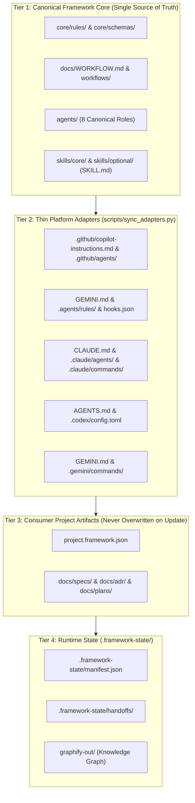

# AI Engineering Framework

[](./LICENSE)
[](./docs/VERSIONING.md)
[](./docs/CONTRIBUTING.md)

**A modular, open-source, platform-independent engineering framework that standardizes the complete Software Development Lifecycle (SDLC) for AI coding agents.**

The **AI Engineering Framework** provides a single canonical source of truth for requirements discovery, specification-driven development, architectural decision records (ADRs), test-driven development (TDD), code review, security validation, and release automation across **GitHub Copilot**, **Google Antigravity**, **Claude Code**, **OpenAI Codex**, and **Gemini CLI**.

---

## Why This Framework Exists

Most AI-assisted development setups suffer from three structural failure modes:
1. **Prompt Sprawl & Vendor Lock-In:** Teams maintain conflicting instructions in `.github/copilot-instructions.md`, `CLAUDE.md`, `AGENTS.md`, and `GEMINI.md`.
2. **Vibe-Coding Drift:** Agents jump straight from a vague user prompt to writing implementation code without clarifying edge cases, documenting architecture, or writing failing tests first.
3. **Multi-Agent "Telephone Game" Degradation:** Passing project context purely through chat summaries causes ~50% information loss across agent handoffs.

**AI Engineering Framework solves this with three core primitives:**
- **Canonical 15-Phase Workflow ([docs/WORKFLOW.md](./docs/WORKFLOW.md)):** Every phase defines explicit inputs, outputs, responsible roles, entry/exit criteria, quality gates, and mandatory human approval checkpoints.
- **Filesystem Handoff Protocol ([core/rules/context-handoff-protocol.md](./core/rules/context-handoff-protocol.md)):** Agents exchange validated artifacts (`docs/specs/`, `docs/adr/`, `.framework-state/handoffs/`) on disk so every specialist agent starts with a clean, unpolluted context window.
- **Thin Platform Adapters ([adapters/](./adapters/)):** Maintain rules, roles, and skills (`SKILL.md`) once; synchronize native configurations for all 5 platforms with `python scripts/sync_adapters.py`.

---

## Architecture Overview



---

## Supported Platforms

| Platform | Entry Point | Adapter Directory | Native Capabilities Mapped |
| :--- | :--- | :--- | :--- |
| **GitHub Copilot** | [`.github/copilot-instructions.md`](./.github/copilot-instructions.md), [`AGENTS.md`](./AGENTS.md) | [`adapters/copilot/`](./adapters/copilot/) | Workspace instructions, scoped `.instructions.md`, `.prompt.md`, `.agent.md`, `.vscode/mcp.json` |
| **Google Antigravity** | [`GEMINI.md`](./GEMINI.md), [`AGENTS.md`](./AGENTS.md) | [`adapters/antigravity/`](./adapters/antigravity/) | `.agents/rules/`, `.agents/skills/`, subagents (`self`, `research`, `browser`), `run_workflow`, `swarm`, `hooks.json` |
| **Claude Code** | [`CLAUDE.md`](./CLAUDE.md) | [`adapters/claude-code/`](./adapters/claude-code/) | `.claude/agents/*.md`, `.claude/commands/*.md`, `.claude/skills/`, `.claude/settings.json` hooks, `.mcp.json` |
| **OpenAI Codex** | [`AGENTS.md`](./AGENTS.md) | [`adapters/codex/`](./adapters/codex/) | Hierarchical `AGENTS.md`, `.agents/skills/*/SKILL.md`, `.codex/config.toml` |
| **Gemini CLI** | [`GEMINI.md`](./GEMINI.md) | [`adapters/gemini-cli/`](./adapters/gemini-cli/) | `GEMINI.md`, `.gemini/commands/*.toml`, `.gemini/settings.json`, `.agents/skills/` |

See [adapters/compatibility-matrix.md](./adapters/compatibility-matrix.md) for detailed feature parity and fallback behavior.

---

## Quick Start

### 1. Validate the Framework Repository
Requires **Python 3.10+** and **Git 2.30+** (zero external `pip` packages required for core scripts):

```bash
python scripts/validate.py
python -m unittest discover -s tests -v
```

### 2. Bootstrap the Framework into a New or Existing Project
Install the canonical rules, templates, and selected platform adapters into any target repository without overwriting existing project files:

```bash
# Preview changes (dry-run)
python scripts/bootstrap.py --target /path/to/your-project --platforms antigravity,copilot,claude-code --dry-run

# Execute non-destructive bootstrap
python scripts/bootstrap.py --target /path/to/your-project --platforms antigravity,copilot,claude-code
```

### 3. Synchronize Platform Adapters After Editing Canonical Rules
```bash
python scripts/sync_adapters.py
python scripts/sync_adapters.py --check
```

---

## Repository Structure

| Path | Tier | Purpose |
| :--- | :--- | :--- |
| [`core/`](./core/) | Tier 1 | Canonical engineering rules (`core/rules/`) and JSON validation schemas (`core/schemas/`) |
| [`agents/`](./agents/) | Tier 1 | 8 vendor-neutral agent role specifications (`product-analyst` through `devops-release-engineer`) |
| [`skills/`](./skills/) | Tier 1 | Modular `SKILL.md` packages (`skills/core/` + opt-in `skills/optional/` packs) and `skills/registry.json` |
| [`workflows/`](./workflows/) | Tier 1 | Step-by-step stage runbooks implementing the 15-phase canonical SDLC |
| [`templates/`](./templates/) | Tier 3 | Artifact templates (`PRD`, `SPEC`, `ADR`, `TEST_PLAN`, `HANDOFF_PACKET`, `project.framework.json`) |
| [`adapters/`](./adapters/) | Tier 2 | Platform-specific adapter configurations and compatibility matrix |
| [`quality/`](./quality/) | Tier 1 | TDD protocol, code review rubric, Definition of Done, and tool classification matrix |
| [`security/`](./security/) | Tier 1 | Security authorization policy, secret prevention rules, and conditional Strix profile template |
| [`integrations/`](./integrations/) | Tier 1 | MCP server templates, Graphify knowledge graph runner, and optional orchestrator specs |
| [`scripts/`](./scripts/) | Tier 1 | Cross-platform Python CLI utilities (`bootstrap.py`, `validate.py`, `sync_adapters.py`) |
| [`docs/`](./docs/) | Tier 1 | Complete documentation suite (Charter, Workflow, Architecture, Installation, Security, Roadmap) |
| [`tests/`](./tests/) | Tier 1 | Automated unit and schema validation test suite |

---

## Documentation Index

- **[Project Charter](./PROJECT_CHARTER.md)** — Vision, scope, non-goals, principles, and milestones.
- **[Canonical Workflow (`docs/WORKFLOW.md`)](./docs/WORKFLOW.md)** — Complete 15-phase operational SDLC specification.
- **[Architecture Guide (`docs/ARCHITECTURE.md`)](./docs/ARCHITECTURE.md)** — 4-tier architecture, state handoffs, and Graphify integration.
- **[Getting Started (`docs/GETTING_STARTED.md`)](./docs/GETTING_STARTED.md)** — End-to-end walkthrough of your first feature using the framework.
- **[Installation Guide (`docs/INSTALLATION.md`)](./docs/INSTALLATION.md)** — Prerequisites, bootstrap modes, and non-destructive updates.
- **[Configuration Reference (`docs/CONFIGURATION.md`)](./docs/CONFIGURATION.md)** — Configuring `project.framework.json`, platform adapters, and optional domain packs.
- **[Security Policy (`docs/SECURITY.md`)](./docs/SECURITY.md)** — Vulnerability reporting, secret prevention, and authorized security testing (Strix).
- **[Versioning Policy (`docs/VERSIONING.md`)](./docs/VERSIONING.md)** — Semantic Versioning (`SemVer 2.0.0`) and schema migration guarantees.
- **[Contributing Guide (`docs/CONTRIBUTING.md`)](./docs/CONTRIBUTING.md)** — How to propose new skills, adapters, and workflow improvements.
- **[Roadmap (`docs/ROADMAP.md`)](./docs/ROADMAP.md)** — Milestone progression from `v0.1.0` through `v1.0.0`.

---

## License & Rationale

This project is licensed under the **[Apache License, Version 2.0](./LICENSE)**.

**Why Apache 2.0?**
1. **Explicit Patent Grant (Section 3):** Protects individual developers and enterprise engineering teams adopting the framework and its scripts against contributor patent litigation.
2. **Clear Derivative Work Rules (Section 4):** Consumer projects can embed, customize, and redistribute framework templates and adapters in proprietary or open-source software without viral copyleft obligations.
3. **Trademark Protection (Section 6):** Preserves the integrity of the official `ai-engineering-framework` name while allowing unrestricted forking and adaptation.
4. **Ecosystem Compatibility:** Fully compatible with the Agent Skills open standard and MIT-licensed dependencies.
