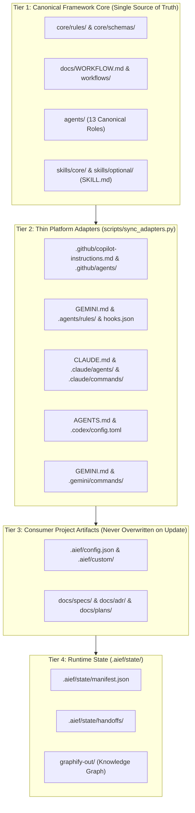

# AI Engineering Framework

[](./LICENSE)
[](./docs/CONTRIBUTING.md#3-semantic-versioning-semver-200--stability)
[](./docs/CONTRIBUTING.md)

**A vendor-neutral engineering workflow, role system, and skill library for AI coding agents.**

It keeps engineering rules, specs, ADRs, TDD checks, and platform configurations in one source of truth synced across **GitHub Copilot**, **Google Antigravity**, **Claude Code**, **OpenAI Codex**, and **Gemini CLI**.

---

## Core Design

Most multi-tool AI setups drift quickly: rules get copied across `CLAUDE.md`, `AGENTS.md`, `GEMINI.md`, and `.github/copilot-instructions.md`, and long agent chats drop edge cases between tasks.

The framework keeps three parts separate:
- **15-Phase Workflow ([docs/WORKFLOW.md](./docs/WORKFLOW.md)):** Explicit inputs, outputs, role ownership, and human approval gates (`Gate-01a`..`Gate-05`) before code, security scans, or releases.
- **Filesystem Handoffs ([core/rules/context-handoff-protocol.md](./core/rules/context-handoff-protocol.md)):** Phase outputs live in `docs/` and `.aief/state/handoffs/` on disk rather than long chat summaries.
- **Platform Adapters ([adapters/](./adapters/)):** Maintain canonical rules, roles, and skills once; generate platform configs with `scripts/sync_adapters.py` (upstream) or `.aief/scripts/compose.py` (consumer repos).

---

## Architecture Overview



---

## Supported Platforms

All **5 platforms** ship complete inline entry files, adapters, native skill projections, custom prompts/MCP support, and schema contracts (`87/87` automated checks green):

| Platform | Entry Point | Adapter & Projection Layout | Status |
| :--- | :--- | :--- | :---: |
| **Google Antigravity** | [`GEMINI.md`](./GEMINI.md), [`AGENTS.md`](./AGENTS.md) | `.agents/rules/`, `.agents/skills/`, `hooks.json` | **`SUPPORTED`** |
| **Claude Code** | [`CLAUDE.md`](./CLAUDE.md), [`AGENTS.md`](./AGENTS.md) | `.claude/skills/`, `.claude/agents/`, `.claude/commands/`, `.claude/settings.json` | **`SUPPORTED`** |
| **GitHub Copilot** | [`.github/copilot-instructions.md`](./.github/copilot-instructions.md), [`AGENTS.md`](./AGENTS.md) | `.github/instructions/`, `.github/prompts/`, `.github/agents/`, `.agents/skills/` | **`SUPPORTED`** |
| **OpenAI Codex** | [`AGENTS.md`](./AGENTS.md) | `.agents/skills/*/SKILL.md`, `.codex/config.toml` | **`SUPPORTED`** |
| **Gemini CLI** | [`GEMINI.md`](./GEMINI.md), [`AGENTS.md`](./AGENTS.md) | `.gemini/commands/*.toml`, `.gemini/settings.json`, `.agents/skills/` | **`SUPPORTED`** |

See [`adapters/compatibility-matrix.md`](./adapters/compatibility-matrix.md) and [`docs/README.md`](./docs/README.md) for full documentation navigation.

---

## Quick Start

### 1. Validate the Framework Repository
Requires **Python 3.11+** and **Git 2.30+** (zero external `pip` packages required for core scripts):

```bash
python scripts/sync_adapters.py --check
python scripts/validate.py --mode framework
python scripts/run_tests.py --fail-on-skip
# Or via standard Python unittest discovery:
python -m unittest discover -s tests -v
```

### 2. Install into a New or Existing Project (Packaged `aief` CLI or Direct Python)
Install via standard Python packaging (`uvx` / `pipx`) or directly from source checkout without overwriting existing project files:

```bash
# Option A: One-command install via uvx / pipx (interactive TUI wizard on TTY; --yes for defaults)
uvx --from git+https://github.com/Raele24/ai-engineering-framework.git aief init /path/to/your-project
# Or install once via pipx install git+https://github.com/Raele24/ai-engineering-framework.git
aief init /path/to/your-project --yes --no-import   # Zero-prompt bootstrap without legacy auto-import
aief init /path/to/your-project --interactive       # Force interactive discovery & legacy migration TUI
aief compose /path/to/your-project

# Option B: Direct invocation from local framework clone
python scripts/bootstrap.py /path/to/your-project
python scripts/bootstrap.py /path/to/your-project --yes --no-import
python scripts/bootstrap.py /path/to/your-project --dry-run
python /path/to/your-project/.aief/scripts/compose.py
python /path/to/your-project/.aief/scripts/preflight.py --stacks dotnet,node/angular
```

### 3. Synchronize Platform Adapters After Editing Canonical Rules
```bash
python scripts/sync_adapters.py
python scripts/sync_adapters.py --check
```

---

## Repository Structure

| Path | Tier | Purpose |
| :--- | :--- | :--- |
| [`core/`](./core/) | Tier 1 | Canonical engineering rules (`core/rules/`), JSON schemas (`core/schemas/`), and `platform-capabilities.json` |
| [`agents/`](./agents/) | Tier 1 | 13 canonical agent role specifications (`ai-engineer` through `ui-ux-designer`) |
| [`skills/`](./skills/) | Tier 1 | Modular `SKILL.md` packages (`skills/core/` + opt-in `skills/optional/` packs) and `skills/registry.json` |
| [`workflows/`](./workflows/) | Tier 1 | Step-by-step stage runbooks implementing the 15-phase canonical SDLC |
| [`templates/`](./templates/) | Tier 3 | Artifact templates (`PRD`, `SPEC`, `ADR`, `TEST_PLAN`, `HANDOFF_PACKET`, `project.framework.json`, stack `.gitignore` presets) |
| [`adapters/`](./adapters/) | Tier 2 | Platform-specific adapter configurations and [`compatibility-matrix.md`](./adapters/compatibility-matrix.md) |
| [`quality/`](./quality/) | Tier 1 | TDD protocol, code review rubric, Definition of Done, and tool classification matrix |
| [`security/`](./security/) | Tier 1 | Security authorization policy, secret prevention rules, and conditional Strix profile template |
| [`integrations/`](./integrations/) | Tier 1 | MCP server templates, Graphify knowledge graph runner, and optional orchestrator specs |
| [`aief_cli/`](./aief_cli/) | Tier 1 | Packaged `aief` CLI entrypoint (`init`, `update`, `compose`, `validate`, `preflight`, `check-sync`) and bundled assets |
| [`scripts/`](./scripts/) | Tier 1 | Pure-stdlib Python CLIs (`bootstrap.py`, `compose.py`, `validate.py`, `sync_adapters.py`, `preflight.py`, `platform_capabilities.py`, `readiness.py`, `run_tests.py`) |
| [`docs/`](./docs/) | Tier 1 | Complete documentation suite (Architecture, Workflow, Getting Started, Consumer Usage Guide, Installation, Security, Roadmap) |
| [`tests/`](./tests/) | Tier 1 | Automated 6-tier offline regression suite (`87` stdlib tests via `scripts/run_tests.py`) |

---

## Documentation Index (`docs/README.md`)

Start from **[`docs/README.md`](./docs/README.md)** for the full structured documentation map. Key guides:

- **[Project Charter](./PROJECT_CHARTER.md)** — Vision, scope, non-goals, principles, and milestones.
- **[Canonical Workflow (`docs/WORKFLOW.md`)](./docs/WORKFLOW.md)** — Complete 15-phase operational SDLC specification.
- **[Architecture Guide (`docs/ARCHITECTURE.md`)](./docs/ARCHITECTURE.md)** — 4-tier architecture, state handoffs, and Graphify integration.
- **[Getting Started & Consumer Usage (`docs/GETTING_STARTED.md`)](./docs/GETTING_STARTED.md)** — Install, first feature walkthrough, session handoffs, and bounded readiness (`v0.7.0`).
- **[Customization & Auto-Loading Guide (`docs/CUSTOMIZATION_GUIDE.md`)](./docs/CUSTOMIZATION_GUIDE.md)** — Recipe guide for `.aief/custom/` (rules, skills, agents, prompts, MCP), `disabled.*` toggles, and `.aief/scripts/compose.py`.
- **[Platform Compatibility Matrix (`adapters/compatibility-matrix.md`)](./adapters/compatibility-matrix.md)** — Configuration mapping and platform support across all 5 platforms.
- **[Installation Guide (`docs/INSTALLATION.md`)](./docs/INSTALLATION.md)** — Prerequisites, `aief` CLI / `bootstrap.py` modes, and non-destructive updates.
- **[Configuration Reference (`docs/CONFIGURATION.md`)](./docs/CONFIGURATION.md)** — Configuring `.aief/config.json`, lockfile `v2.0.0`, ownership classes, and validation severities.
- **[Security Policy (`docs/SECURITY.md`)](./docs/SECURITY.md)** — Vulnerability reporting, secret prevention, and authorized security testing (Strix).
- **[Skills Catalog & Matrix (`docs/SKILL_COMPATIBILITY_MATRIX.md`)](./docs/SKILL_COMPATIBILITY_MATRIX.md)** — Packs, Policy A/B/C, external CLIs (`rtk`, `graphify`), and compatibility matrix for all 37 skills.
- **[Token Optimization Guide (`docs/TOKEN_OPTIMIZATION.md`)](./docs/TOKEN_OPTIMIZATION.md)** — Progressive disclosure principles, Ponytail, Caveman, RTK, and filesystem context offloading.
- **[Changelog (`CHANGELOG.md`)](./CHANGELOG.md)** — Release history from `v0.1.0` through `v0.7.0`.
- **[Contributing, Versioning & Release (`docs/CONTRIBUTING.md`)](./docs/CONTRIBUTING.md)** — Authoring rules, SemVer `2.0.0`, release checklist, and commit conventions.
- **[Roadmap (`docs/ROADMAP.md`)](./docs/ROADMAP.md)** — Release progression from `v0.1.0` through `v0.7.0+`.

---

## License & Rationale

This project is licensed under the **[Apache License, Version 2.0](./LICENSE)**.

**Why Apache 2.0?**
1. **Explicit Patent Grant (Section 3):** Protects individual developers and enterprise engineering teams adopting the framework and its scripts against contributor patent litigation.
2. **Clear Derivative Work Rules (Section 4):** Consumer projects can embed, customize, and redistribute framework templates and adapters in proprietary or open-source software without viral copyleft obligations.
3. **Trademark Protection (Section 6):** Preserves the integrity of the official `ai-engineering-framework` name while allowing unrestricted forking and adaptation.
4. **Ecosystem Compatibility:** Fully compatible with the Agent Skills open standard and MIT-licensed dependencies.
