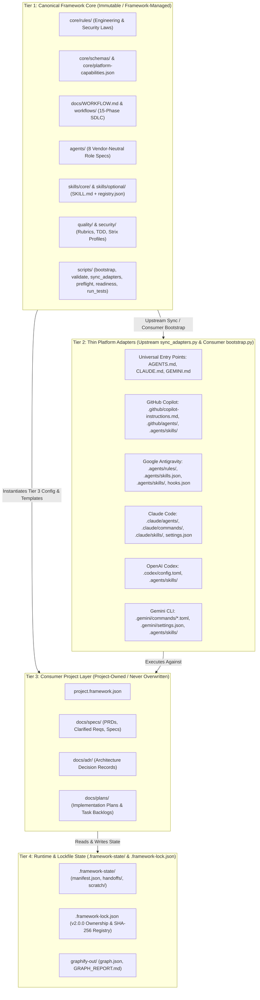

# Architecture Guide (`ARCHITECTURE.md`)

**Status:** Canonical Architecture Specification  
**Version:** `0.4.0`  

---

## 1. Architectural Vision

The **AI Engineering Framework** is designed as a **layered, vendor-neutral engineering operating system** for AI coding agents. Its primary architectural goal is to decouple **what software engineering discipline requires** (the Canonical Core) from **how individual AI coding platforms load instructions, tools, and subagents** (the Platform Adapter Layer).

---

## 2. Four-Tier Layered Architecture

### 2.1 Why Four Tiers?
1. **Zero Config Drift (Tier 1 $\rightarrow$ Tier 2):** Editing a rule in `core/rules/`, capability metadata in `core/platform-capabilities.json`, a role in `agents/`, or `workflows/` requires running `python scripts/sync_adapters.py` in the upstream framework repo. When installing into a consumer repo, `scripts/bootstrap.py` projects consumer-safe adapter templates (pointing to `validate.py --mode consumer`, never `sync_adapters.py`) and native skill folders (`.agents/skills/<name>/` and, when `claude-code` is enabled, `.claude/skills/<name>/`).
2. **Safe Downstream Upgrades & Six-Class Ownership (Tier 1/2 vs. Tier 3):** When a consumer project upgrades (including automatic migration from legacy `v0.3.0` lockfiles with backup to `.framework-state/lock-backups/framework-lock-v0.3.0.json`) via `python scripts/bootstrap.py --update`, `.framework-lock.json` (`schema_version: "2.0.0"`) tracks ownership across `framework_managed`, `platform_projected_skill`, `consumer_owned`, `consumer_customized_generated`, `obsolete_framework_managed`, and `unknown_untracked`. Unmodified managed/projected files update cleanly via two-phase atomic writes; locally modified files are preserved; deselected packs or removed exclusive platforms are pruned safely only with verified provenance and reparse/traversal guards.
3. **Clean Version Control (Tier 3 vs. Tier 4):** Ephemeral orchestration checkpoints in `.framework-state/` (including `.framework-state/scratch/`) are git-ignored by default while permanent engineering decisions (`docs/specs/`, `docs/adr/`) and `project.framework.json` remain under project Git control.

---

## 3. Component Responsibilities & Dependencies

| Component | Path | Responsibility | Upstream Dependencies | Downstream Consumers |
| :--- | :--- | :--- | :--- | :--- |
| **Core Rules** | `core/rules/` | Defines non-negotiable engineering, approval, context-handoff, and security invariants | None | All agents, workflows, and platform adapters |
| **Core Schemas & Capabilities** | `core/schemas/`, `core/platform-capabilities.json` | Defines JSON schemas for roles, skills, handoffs, and config, plus declarative verified platform capability states | None | `scripts/platform_capabilities.py`, `scripts/validate.py`, `scripts/bootstrap.py`, `scripts/sync_adapters.py` |
| **Canonical Roles** | `agents/` | Defines the 8 specialized engineering roles, tool permissions, and boundaries | `core/schemas/agent-role.schema.json` | `workflows/`, `adapters/` |
| **Skill Library & Projections** | `skills/`, `.agents/skills/`, `.claude/skills/` | Stores canonical `core/` and `optional/` runbooks (`SKILL.md`, `registry.json`); `bootstrap.py` projects active skills into native runtime directories (excluding `UPSTREAM_SKILL.md`/`__pycache__`) and rewrites relocated links | `core/schemas/skill-frontmatter.schema.json`, `core/platform-capabilities.json` | `agents/`, host skill loaders |
| **Workflow Runbooks** | `workflows/` | Operational stage playbooks implementing the 15 phases of `docs/WORKFLOW.md` (incl. PowerShell 5.1 & readiness protocols) | `core/rules/`, `agents/`, `skills/` | Host agents, slash commands, orchestrators |
| **Platform Adapters** | `adapters/` | Maps canonical roles, rules, tools, and workflows to native platform files; evidence status tracked in `core/platform-capabilities.json` | `core/`, `agents/`, `skills/`, `workflows/` | Antigravity (`RUNTIME_VERIFIED`), Codex (`PARTIAL_RUNTIME_VERIFIED`), Copilot / Claude Code / Gemini CLI (`CONTRACT_VALIDATED`) |
| **Quality & Security** | `quality/`, `security/` | Enforces TDD contracts, review rubrics, secret scanning, and Strix authorization (`Gate-Sec`) | `core/rules/security-guardrails.md` | Phases 9–12 (`implementation-engineer`, `code-reviewer`, `qa-engineer`, `security-engineer`) |
| **Integrations** | `integrations/` | Bridges optional MCP servers, Graphify knowledge graphs, RTK, and external orchestrators | `core/` | Optional project workflows |
| **CLI Scripts** | `scripts/`, `aief_cli/` | Pure-stdlib utilities: `bootstrap.py`, `compose.py`, `validate.py`, `sync_adapters.py`, `preflight.py`, `platform_capabilities.py`, `readiness.py`, `run_tests.py` + `aief` CLI | Python 3.11+ stdlib, `core/schemas/` | Developers, agents, consumer repos, CI runners |

---

## 4. Context Engineering & Multi-Agent Topology

The framework incorporates modern context engineering principles (`context-fundamentals`, `multi-agent-patterns`, `filesystem-context`):

### 4.1 Context Isolation Over Anthropomorphism
Multiple agents exist in this framework **to isolate context windows**, not to simulate corporate bureaucracy:
- **Single-Agent Sequential Mode:** On platforms or tasks where a single agent executes the workflow, the agent transitions across phases by writing the phase handoff file to `.framework-state/handoffs/` and compacting/clearing prior conversational noise before starting the next stage.
- **Supervisor / Subagent Mode:** On platforms supporting subagents (Google Antigravity `invoke_subagent` / `run_workflow` / `swarm`, Claude Code subagents), `planner-orchestrator` dispatches fresh subagent instances with only the specific input files (`input_artifacts`) required for that task.
- **Hard Worker Cap:** A supervisor turn never spawns more than **3 to 5 concurrent workers**, preventing supervisor context saturation.

### 4.2 Progressive Skill Disclosure & Domain Isolation
Loading every guideline into the global system prompt causes the **Lost-in-the-Middle Effect** and wastes token budget.
- **Always-On Context (`AGENTS.md` / `CLAUDE.md` / `GEMINI.md`):** Kept concise. Contains only core workflow routing, safety/approval gates, and a compact metadata index (`9,098 bytes` / `~2,274 tokens` in total for `AGENTS.md` across all 33 registered skills — keeping full `SKILL.md` bodies out of startup context).
- **On-Demand Context (`skills/`):** Organized into `skills/core/` (8 core SDLC, YAGNI `ponytail`, and `graphify` skills) and 5 isolated optional domain packs (`communication`, `context-engineering`, `agent-architecture`, `frontend-design`, `growth-media`). See [`docs/SKILL_COMPATIBILITY_MATRIX.md`](./SKILL_COMPATIBILITY_MATRIX.md) and [`docs/TOKEN_OPTIMIZATION.md`](./TOKEN_OPTIMIZATION.md).
- **Offline Script & Database Execution:** Heavy reference assets (such as the 28 CSV databases in `ui-ux-pro-max` or the 36 Angular guides in `angular-developer`) remain on disk and are queried via standard-library Python scripts (`search.py`) or targeted `read_file` calls.

---

## 5. Codebase Knowledge Graph Integration (`Graphify`)

To prevent architectural drift and blind file grepping on medium-to-large repositories, the framework integrates **Graphify (`graphify 0.9.48`)** as a first-class architectural component ([`skills/core/graphify/SKILL.md`](../skills/core/graphify/SKILL.md)):

1. **Minimum Corpus Threshold Guard:** Only build or update `graphify-out/` when a repository has **$\ge 15$ tracked code/doc files OR $> 2,000$ lines of code**. For tiny projects ($< 15$ files), agents read files directly to avoid unnecessary graph overhead.
2. **Knowledge Graph Generation (`graphify .` / `graphify update .`):** Parses repository source code, SQL schemas, and documentation into `graphify-out/graph.json` and `graphify-out/GRAPH_REPORT.md` using local deterministic `tree-sitter` AST parsing (zero external LLM API cost).
3. **Phase 1 & 4 (Discovery & Research):** When `graphify-out/graph.json` exists, agents query the graph (`graphify query "<question>"`, `graphify path "<A>" "<B>"`, `graphify explain "<node>"`, `graphify god-nodes`) before scanning raw directory trees.
4. **Phase 10 & 14 (Code Review & Docs):** Agents run `graphify update .` to incrementally refresh the AST/concept graph and verify that new changes do not introduce unintended god-nodes or cross-layer couplings.

---

## 6. Key Architecture Decision Records (ADRs)

All major architectural decisions for the framework itself are recorded under [`docs/adr/`](./adr/):
- **[ADR-0001: Open-Source Licensing under Apache 2.0](./adr/ADR-0001-open-source-license.md)**
- **[ADR-0002: Single Canonical Core with Thin Platform Adapters](./adr/ADR-0002-canonical-core-and-thin-adapters.md)**
- **[ADR-0003: Filesystem State Handoffs over Conversational Memory](./adr/ADR-0003-filesystem-state-handoffs.md)**
