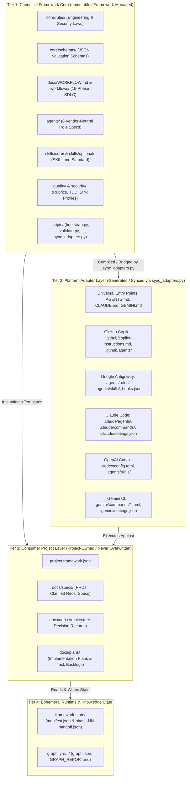

# Architecture Guide (`ARCHITECTURE.md`)

**Status:** Canonical Architecture Specification  
**Version:** `0.1.0`  

---

## 1. Architectural Vision

The **AI Engineering Framework** is designed as a **layered, vendor-neutral engineering operating system** for AI coding agents. Its primary architectural goal is to decouple **what software engineering discipline requires** (the Canonical Core) from **how individual AI coding platforms load instructions, tools, and subagents** (the Platform Adapter Layer).

---

## 2. Four-Tier Layered Architecture

### 2.1 Why Four Tiers?
1. **Zero Config Drift (Tier 1 $\rightarrow$ Tier 2):** Editing a rule in `core/rules/` or adding an agent role in `agents/` requires running `python scripts/sync_adapters.py`. The script regenerates or verifies all platform adapter files so Copilot, Antigravity, Claude Code, Codex, and Gemini CLI never diverge.
2. **Safe Downstream Upgrades (Tier 1/2 vs. Tier 3):** When a consumer project upgrades from Framework `v0.1.0` to `v0.2.0` via `python scripts/bootstrap.py --update`, only unmodified Tier 1 and Tier 2 files tracked in `.framework-lock.json` are updated. Tier 3 project artifacts (`project.framework.json`, `docs/specs/`, `docs/adr/`, application source code) are never overwritten.
3. **Clean Version Control (Tier 3 vs. Tier 4):** Ephemeral orchestration checkpoints in `.framework-state/` are git-ignored by default while permanent engineering decisions (`docs/specs/`, `docs/adr/`) are committed to Git.

---

## 3. Component Responsibilities & Dependencies

| Component | Path | Responsibility | Upstream Dependencies | Downstream Consumers |
| :--- | :--- | :--- | :--- | :--- |
| **Core Rules** | `core/rules/` | Defines non-negotiable engineering, approval, context-handoff, and security invariants | None | All agents, workflows, and platform adapters |
| **Core Schemas** | `core/schemas/` | Defines JSON schemas for roles, skills, handoff packets, and project config | None | `scripts/validate.py`, `scripts/bootstrap.py` |
| **Canonical Roles** | `agents/` | Defines the 8 specialized engineering roles, tool permissions, and boundaries | `core/schemas/agent-role.schema.json` | `workflows/`, `adapters/` |
| **Skill Library** | `skills/` | Provides on-demand procedural runbooks (`SKILL.md`) split into `core/` and `optional/` | `core/schemas/skill-frontmatter.schema.json` | `agents/`, host skill loaders (`.agents/skills/`) |
| **Workflow Runbooks** | `workflows/` | Operational stage playbooks implementing the 15 phases of `docs/WORKFLOW.md` | `core/rules/`, `agents/`, `skills/` | Host agents, slash commands, orchestrators |
| **Platform Adapters** | `adapters/` | Maps canonical roles, rules, and workflows to native platform files | `core/`, `agents/`, `skills/`, `workflows/` | Copilot, Antigravity, Claude Code, Codex, Gemini CLI |
| **Quality & Security** | `quality/`, `security/` | Enforces TDD contracts, review rubrics, secret scanning, and Strix authorization | `core/rules/security-guardrails.md` | Phases 9–12 (`implementation-engineer`, `code-reviewer`, `qa-engineer`, `security-engineer`) |
| **Integrations** | `integrations/` | Bridges optional MCP servers, Graphify knowledge graphs, and external orchestrators | `core/` | Optional project workflows |
| **CLI Scripts** | `scripts/` | Cross-platform Python utilities for bootstrap, adapter sync, and validation | Python 3.10+ stdlib, `core/schemas/` | Developers, agents, and GitHub Actions CI |

---

## 4. Context Engineering & Multi-Agent Topology

The framework incorporates modern context engineering principles (`context-fundamentals`, `multi-agent-patterns`, `filesystem-context`):

### 4.1 Context Isolation Over Anthropomorphism
Multiple agents exist in this framework **to isolate context windows**, not to simulate corporate bureaucracy:
- **Single-Agent Sequential Mode:** On platforms or tasks where a single agent executes the workflow, the agent transitions across phases by writing the phase handoff file to `.framework-state/handoffs/` and compacting/clearing prior conversational noise before starting the next stage.
- **Supervisor / Subagent Mode:** On platforms supporting subagents (Google Antigravity `invoke_subagent` / `run_workflow` / `swarm`, Claude Code subagents), `planner-orchestrator` dispatches fresh subagent instances with only the specific input files (`input_artifacts`) required for that task.
- **Hard Worker Cap:** A supervisor turn never spawns more than **3 to 5 concurrent workers**, preventing supervisor context saturation.

### 4.2 Progressive Skill Disclosure
Loading every guideline into the global system prompt causes the **Lost-in-the-Middle Effect** and wastes token budget.
- **Always-On Context (`AGENTS.md` / `CLAUDE.md` / `GEMINI.md`):** Kept concise (< 4 KB). Contains only core workflow routing, safety/approval gates, and pointers to canonical files.
- **On-Demand Context (`skills/`):** Loaded only when an agent enters a matching workflow phase or domain task (e.g., `tdd-cycle` during Phase 9; `web-design-guidelines` only when touching frontend UI).

---

## 5. Codebase Knowledge Graph Integration (`Graphify`)

To prevent architectural drift and blind file grepping on medium-to-large repositories, the framework integrates **Graphify (`graphify`)** as a first-class architectural component:

1. **Knowledge Graph Generation (`graphify .`):** Parses repository source code, documentation, and relationships into `graphify-out/graph.json` and `graphify-out/GRAPH_REPORT.md`.
2. **Phase 1 & 4 (Discovery & Research):** When `graphify-out/graph.json` exists, agents query the graph (`graphify query "<question>"`, `graphify path "<A>" "<B>"`, `graphify explain "<node>"`) before scanning raw directory trees.
3. **Phase 10 & 14 (Code Review & Docs):** Agents run `graphify update .` to incrementally refresh the AST/concept graph and verify that new changes do not introduce unintended god-nodes or cross-layer couplings.

---

## 6. Key Architecture Decision Records (ADRs)

All major architectural decisions for the framework itself are recorded under [`docs/adr/`](./adr/):
- **[ADR-0001: Open-Source Licensing under Apache 2.0](./adr/ADR-0001-open-source-license.md)**
- **[ADR-0002: Single Canonical Core with Thin Platform Adapters](./adr/ADR-0002-canonical-core-and-thin-adapters.md)**
- **[ADR-0003: Filesystem State Handoffs over Conversational Memory](./adr/ADR-0003-filesystem-state-handoffs.md)**
