# AI Engineering Framework — Implementation Plan & Architecture Blueprint

**Project:** AI Engineering Framework (`ai-engineering-framework`)  
**Version:** `0.1.0-draft`  
**Date:** 2026-11-16  
**Author Role:** Technical Project Lead, Software Architect & DevOps Engineer  
**Target Repository:** `https://github.com/Raele24/ai-engineering-framework`

---

## 1. Executive Summary & Architectural Decisions

The **AI Engineering Framework** is an open-source, platform-independent engineering methodology and technical toolkit for software development executed by AI coding agents under balanced human governance.

Unlike prompt collections or single-vendor plugins, this framework defines a **Canonical Software Development Lifecycle (SDLC)** stored in vendor-neutral files (`core/`, `workflows/`, `agents/`, `skills/`, `templates/`), backed by **file-system state handoffs** (`.framework-state/`) and compiled/bridged through **thin platform adapters** (`adapters/`) for GitHub Copilot, Google Antigravity, Claude Code, OpenAI Codex, and Gemini CLI.

### 1.1 Key Architectural Decisions (Proposed Defaults for Review)

Where consequential project decisions were open, the following defaults are proposed with explicit engineering rationale:

| Decision ID | Topic | Proposed Default | Rationale | Alternative |
| :--- | :--- | :--- | :--- | :--- |
| **DEC-01** | **Workspace Directory** | `D:\PROGETTI\ai-engineering-framework` *(Approved)* | Relocated from `C:\Users\raele\.gemini\antigravity\scratch\ai-engineering-framework` with verified SHA-256 file integrity to match host project root. | `C:\Users\raele\.gemini\antigravity\scratch\ai-engineering-framework` |
| **DEC-02** | **Open-Source License** | **Apache License 2.0** *(Approved)* | Provides an explicit patent grant, protects contributors and enterprise adopters, and prevents trademark confusion while remaining permissive and compatible with MIT/Agent Skills. | **MIT License** (shorter, minimal clauses, no explicit patent grant) |
| **DEC-03** | **Automation & CLI Scripting Runtime** | **Python 3.12+** (Standard Library + `PyYAML`/`pydantic` optional) | Verified `Python 3.13.14` is installed on host; avoids Windows PowerShell 5.1 vs. Bash syntax incompatibilities across Windows, macOS, and Linux. | Node.js (`.mjs`) scripts |
| **DEC-04** | **Git Default Branch & Line Endings** | `main` branch + `.gitattributes` enforcing `LF` for code/configs (`.ps1`/`.bat` as `CRLF`) | Overrides host `init.defaultbranch=master` and prevents cross-platform `core.autocrlf` drift in shell scripts and YAML frontmatter. | Platform-native line endings |
| **DEC-05** | **Codebase Knowledge Graph** | **Graphify (`graphify 0.9.48`)** integrated into Architecture & Review phases | Verified installed on host (`0.9.48`); provides deterministic AST + semantic graph analysis (`graphify-out/`) for impact analysis and architectural validation. | Manual file traversal only |

---

## 2. Complete Project Roadmap & Implementation Phases

The implementation is structured into **9 sequential phases** across **6 milestones (M0–M5)** to ensure incremental validation and zero uncontrolled changes.

```mermaid
flowchart LR
    P1["Phase 1: Environment Audit (Done)"] --> P2["Phase 2: Foundation Docs"]
    P2 --> P3["Phase 3: Repo Architecture"]
    P3 --> P4["Phase 4: Agents & Skills"]
    P4 --> P5["Phase 5: Platform Adapters"]
    P5 --> P6["Phase 6: Quality & Security"]
    P6 --> P7["Phase 7: Advanced Modules"]
    P7 --> P8["Phase 8: Orchestration"]
    P8 --> P9["Phase 9: GitHub, Bootstrap & CI/CD"]
```



### Phase 1 — Environment and Capability Audit *(Completed)*
- **Deliverables:** `docs/ENVIRONMENT_AUDIT.md`, `docs/IMPLEMENTATION_PLAN.md`.
- **Outcome:** Empirical verification of Windows 11 (`10.0.26300`), PowerShell 5.1, Git `2.50.1`, Python `3.13.14`, Node.js `v24.12.0`, Graphify `0.9.48`, Antigravity `1.5.9`, cached GitHub HTTPS credentials (`Raele24`), and identification of missing tools (`gh`, `docker`, `pwsh`).

### Phase 2 — Project Foundation & Canonical Documentation
- **Deliverables:**
  - `PROJECT_CHARTER.md`: Vision, mission, scope, target users, goals/non-goals, architectural principles, supported platforms, success criteria, milestones.
  - `README.md`: High-signal overview, architecture diagram, quickstart, platform matrix, license.
  - `docs/WORKFLOW.md`: **Operational 15-phase canonical SDLC** with inputs, outputs, responsible roles, skills, entry/exit criteria, quality gates, human approval gates, failure recovery, and `.framework-state/` file-handoff contracts.
  - `docs/ARCHITECTURE.md`: 4-layer architecture (Canonical Core, Skill & Role Registry, Platform Adapter Layer, Consumer Project Runtime State) + Graphify integration.
  - `docs/GETTING_STARTED.md`, `docs/INSTALLATION.md`, `docs/CONFIGURATION.md`, `docs/CONTRIBUTING.md`, `docs/VERSIONING.md`, `docs/SECURITY.md`, `docs/ROADMAP.md`.

### Phase 3 — Repository Architecture & Core Schemas
- **Deliverables:** Directory structure initialization, JSON/YAML schemas for framework manifest (`core/schemas/`), canonical rules (`core/rules/`), handoff state templates (`templates/`), and strict 4-tier separation between reusable framework assets, platform adapters, project-specific configs, and runtime state.

### Phase 4 — Agent Role & Skill System
- **Deliverables:**
  - Canonical Agent Role definitions in `agents/` (rationalized to 8 non-redundant roles).
  - Core framework skills in `skills/core/` following the **Agent Skills (`SKILL.md`) Open Standard**.
  - External skill governance, security evaluation checklist, and lockfile manifest (`skills/registry.json`).

### Phase 5 — Platform Adapters
- **Deliverables:**
  - Shared root entry points (`AGENTS.md`, `CLAUDE.md`, `GEMINI.md`) referencing canonical rules rather than duplicating them.
  - Adapter generator/sync utility (`scripts/sync_adapters.py`) and platform adapter packages under `adapters/` for:
    1. **GitHub Copilot** (`.github/copilot-instructions.md`, `.github/instructions/`, `.github/prompts/`, `.github/agents/`)
    2. **Google Antigravity** (`.agents/rules/`, `.agents/skills/`, `hooks.json`, `mcp_config.json`)
    3. **Claude Code** (`CLAUDE.md`, `.claude/agents/`, `.claude/commands/`, `.claude/settings.json`)
    4. **OpenAI Codex** (`AGENTS.md`, `.codex/config.toml`, `.agents/skills/`)
    5. **Gemini CLI** (`GEMINI.md`, `.gemini/settings.json`, `.gemini/commands/`)

### Phase 6 — Quality, Testing, and Security System
- **Deliverables:**
  - `quality/` checklists, TDD contract templates, Graphify architectural validation rules, and test pyramid configurations.
  - `security/` policies, threat model template, secret-scanning patterns, dependency audit rules, and **authorized security testing integration** (including **Strix** configuration profile and **Playwright** E2E security/smoke checks).

### Phase 7 — Advanced Workflows & Optional Domain Modules
- **Deliverables:**
  - Core engineering workflow skills (`grill-me`, `caveman`, `anti-slop`, `find-skills`, `agent-browser`).
  - Optional domain packs isolated under `skills/optional/frontend-design/` (`web-design-guidelines`, `canvas-design`) and `skills/optional/growth-media/` (`seo-audit`, `ai-seo`, `video-lens`, `video-use`, `content-strategy`, `pricing`) so they never clutter core backend/infrastructure engineering runs.

### Phase 8 — Orchestration Strategy
- **Deliverables:**
  - Native host orchestration specification (`workflows/orchestration/native.md`) using file-backed state machines (`.framework-state/manifest.json`) that require zero external daemons.
  - Optional external orchestrator evaluation & adapter specs (`integrations/orchestrators/`) covering Paperclip, LangGraph, CrewAI, and AutoGen.

### Phase 9 — GitHub Repository, Bootstrap CLI, Validation CLI, and CI/CD
- **Deliverables:**
  - `.gitignore`, `.gitattributes`, `LICENSE` (Apache 2.0), `.github/ISSUE_TEMPLATE/`, `.github/PULL_REQUEST_TEMPLATE.md`.
  - `.github/workflows/ci-validate.yml` (validates markdown links, YAML frontmatter, JSON schemas, adapter sync, and Python script tests) and `.github/workflows/security.yml`.
  - `scripts/bootstrap.py`: Non-destructive installer/updater that initializes or updates the framework inside any target project without overwriting project-specific files.
  - `scripts/validate.py`: Health-check CLI verifying framework integrity, adapter sync, and environment readiness.
  - Automated unit tests (`tests/test_framework.py`) + Graphify knowledge graph generation (`graphify-out/`).

---

## 3. Proposed Repository Structure & Separation of Concerns (Phase 3)

### 3.1 Four-Tier Separation Model

To guarantee maintainability and safe upgrades in downstream projects, every file belongs to one of four strict tiers:

1. **Tier 1 — Framework-Wide Reusable Assets (Versioned in Framework Repo):**
   `core/`, `agents/`, `skills/`, `workflows/`, `quality/`, `security/`, `scripts/`.
2. **Tier 2 — Platform-Specific Adapter Configurations (Generated/Synced from Tier 1):**
   `adapters/` and root pointer files (`AGENTS.md`, `CLAUDE.md`, `GEMINI.md`, `.github/copilot-instructions.md`).
3. **Tier 3 — Project-Specific Configurations & Artifacts (Owned by Consumer Project, Never Overwritten on Update):**
   `project.framework.json` (or `.framework/config.json`), `docs/specs/`, `docs/adr/`, `docs/plans/` generated from `templates/`.
4. **Tier 4 — Runtime State & External Orchestration Data (Git-Ignored or Ephemeral Run State):**
   `.framework-state/` (active phase handoff packets, checkpoints, logs), `graphify-out/` (optional local cache), `.env` (never committed).

### 3.2 Directory Architecture

```text
ai-engineering-framework/
├── .github/
│   ├── ISSUE_TEMPLATE/
│   │   ├── bug_report.yml
│   │   └── feature_request.yml
│   ├── workflows/
│   │   ├── ci-validate.yml          # Validates schemas, frontmatter, adapters, and Python tests
│   │   └── security-audit.yml       # Secret scanning, dependency review, optional Strix workflow
│   ├── PULL_REQUEST_TEMPLATE.md
│   └── copilot-instructions.md      # Thin adapter pointer for GitHub Copilot
├── adapters/                        # Platform-specific adapter templates & sync mappings
│   ├── antigravity/                 # .agents/rules, hooks.json, mcp_config.json template
│   ├── claude-code/                 # .claude/agents, .claude/commands, settings.json template
│   ├── codex/                       # .codex/config.toml & AGENTS.md mapping
│   ├── copilot/                     # .github/instructions, .github/prompts, .github/agents
│   ├── gemini-cli/                  # .gemini/settings.json & .gemini/commands/*.toml
│   └── compatibility-matrix.md      # Verified feature support across all 5 platforms
├── agents/                          # Canonical role definitions (vendor-neutral Markdown + YAML)
│   ├── product-analyst.md           # Discovery, Grill Me interviews, PRD & acceptance criteria
│   ├── software-architect.md        # Technical research, system design, ADRs, Graphify analysis
│   ├── planner-orchestrator.md      # Task decomposition, phase routing, handoff verification
│   ├── implementation-engineer.md   # TDD, backend/frontend/data implementation
│   ├── code-reviewer.md             # Diff review, architectural drift, anti-slop enforcement
│   ├── qa-engineer.md               # Unit/integration/E2E testing, Playwright validation
│   ├── security-engineer.md         # Threat modeling, SAST/secret audit, authorized Strix runs
│   └── devops-release-engineer.md   # CI/CD, environments, deployment, rollback, versioning
├── core/                            # Canonical invariants, rules, and JSON schemas
│   ├── rules/
│   │   ├── engineering-principles.md
│   │   ├── context-handoff-protocol.md
│   │   ├── human-approval-gates.md
│   │   └── security-guardrails.md
│   └── schemas/
│       ├── agent-role.schema.json
│       ├── skill-frontmatter.schema.json
│       ├── handoff-packet.schema.json
│       └── framework-config.schema.json
├── docs/                            # Comprehensive framework documentation
│   ├── ENVIRONMENT_AUDIT.md
│   ├── IMPLEMENTATION_PLAN.md
│   ├── ARCHITECTURE.md
│   ├── WORKFLOW.md
│   ├── GETTING_STARTED.md
│   ├── INSTALLATION.md
│   ├── CONFIGURATION.md
│   ├── CONTRIBUTING.md
│   ├── VERSIONING.md
│   ├── SECURITY.md
│   └── ROADMAP.md
├── integrations/                    # Optional external tool & orchestrator integrations
│   ├── mcp/                         # Curated, security-vetted MCP server templates
│   ├── graphify/                    # Codebase knowledge graph integration guide & runner
│   └── orchestrators/               # Evaluation & adapter patterns for Paperclip, LangGraph, etc.
├── quality/                         # Framework-wide quality gates & TDD contracts
│   ├── tdd-protocol.md
│   ├── code-review-rubric.md
│   ├── definition-of-done.md
│   └── tool-classification.md       # Core / Recommended / Optional / Conditional matrix
├── scripts/                         # Cross-platform zero-dependency Python CLI utilities
│   ├── bootstrap.py                 # Installs/updates framework into target repo non-destructively
│   ├── validate.py                  # Validates installation, schemas, frontmatter, and adapters
│   └── sync_adapters.py             # Generates thin platform adapter files from canonical core
├── security/                        # Security policies, checklists, and authorized scanner configs
│   ├── authorization-policy.md      # Mandatory scope & authorization rules before active testing
│   ├── pre-commit-secrets.md        # Secret & credential prevention rules
│   └── strix-profile.yaml           # Conditional authorized AI security testing template
├── skills/                          # Modular Agent Skills (SKILL.md standard)
│   ├── registry.json                # Versioned catalog, tier classification, security hash/audit
│   ├── core/                        # Core SDLC skills (grill-me, tdd-cycle, adr-writer, etc.)
│   └── optional/                    # Opt-in domain packs
│       ├── communication/           # caveman, anti-slop
│       ├── frontend-design/         # web-design-guidelines, canvas-design
│       └── growth-media/            # seo-audit, ai-seo, video-lens, video-use, content-strategy, pricing
├── templates/                       # Reusable artifact templates for consumer projects
│   ├── PRD.template.md
│   ├── SPEC.template.md
│   ├── ADR.template.md
│   ├── TEST_PLAN.template.md
│   ├── HANDOFF_PACKET.template.json
│   └── project.framework.json       # Consumer project configuration template
├── tests/                           # Automated test suite for framework scripts & schemas
│   └── test_framework.py
├── workflows/                       # Executable phase runbooks mapping to docs/WORKFLOW.md
│   ├── 01-discovery-and-grill-me.md
│   ├── 02-specification-and-adr.md
│   ├── 03-planning-and-decomposition.md
│   ├── 04-tdd-and-implementation.md
│   ├── 05-review-qa-and-security.md
│   └── 06-release-and-retrospective.md
├── .gitattributes
├── .gitignore
├── AGENTS.md                        # Universal entry point (Codex, Antigravity, Cursor, Copilot)
├── CLAUDE.md                        # Claude Code entry point (imports AGENTS.md / core rules)
├── GEMINI.md                        # Gemini CLI & Antigravity entry point
├── LICENSE
├── PROJECT_CHARTER.md
└── README.md
```

### 3.3 Directory Responsibility Matrix

| Directory | Responsibility | Contents | Dependencies | Relationship to Canonical Workflow |
| :--- | :--- | :--- | :--- | :--- |
| `core/` | Defines immutable framework laws, handoff contracts, and JSON schemas | Markdown rules, JSON schemas | None (Root dependency) | Governs quality gates, state transitions, and approval rules across all 15 phases |
| `agents/` | Defines canonical agent personas, boundaries, inputs/outputs, and tool scopes | 8 vendor-neutral role specs | `core/schemas/agent-role.schema.json`, `skills/` | Assigns exact role ownership to every SDLC phase |
| `skills/` | Provides progressive-disclosure procedural runbooks (`SKILL.md`) | `core/` skills, `optional/` domain packs, `registry.json` | `core/schemas/skill-frontmatter.schema.json` | Invoked on-demand by agents during specific workflow steps |
| `workflows/` | Operational stage playbooks and handoff state transitions | 6 stage runbooks covering the 15 canonical phases | `core/`, `agents/`, `skills/`, `templates/` | Implements `docs/WORKFLOW.md` as step-by-step agent instructions |
| `templates/` | Standardized artifact skeletons for project deliverables | PRD, Spec, ADR, Test Plan, Handoff JSON templates | `core/schemas/` | Defines the exact structure of phase outputs in consumer projects |
| `adapters/` | Bridges canonical files into vendor-specific directory/config formats | Copilot, Antigravity, Claude Code, Codex, Gemini CLI configs | `core/`, `agents/`, `skills/`, `scripts/sync_adapters.py` | Translates canonical workflow into native platform primitives |
| `integrations/` | Optional bridges to MCP servers, Graphify, and external orchestrators | MCP templates, Graphify guide, Paperclip/LangGraph specs | `core/`, host tools | Extends workflow with optional context/orchestration capabilities |
| `quality/` | Enforces TDD, code review rubrics, static analysis, and tool tiers | Rubrics, TDD rules, tool matrix | `core/rules/` | Governs Phases 9, 10, and 11 (TDD, Code Review, Automated Testing) |
| `security/` | Enforces secret prevention, dependency auditing, and authorized pentesting | Scope policies, Strix templates, checklists | `core/rules/security-guardrails.md` | Governs Phase 12 (Security Validation) |
| `scripts/` | Automates bootstrap, non-destructive updates, adapter sync, and validation | `bootstrap.py`, `validate.py`, `sync_adapters.py` | Python 3.12+ standard library | Initializes and validates the framework in any repository |
| `docs/` | Human and agent reference documentation | Charter, Workflow, Architecture, Guides | All directories | Canonical documentation source of truth |
| `.github/` | Repository governance, issue/PR templates, and CI/CD pipelines | GitHub Actions, templates, Copilot adapter | `scripts/validate.py` | Automates Phase 13 (CI/CD & Release) and repository validation |

---

## 4. Canonical Workflow Design Overview (Phase 2 — `docs/WORKFLOW.md`)

`docs/WORKFLOW.md` defines **15 operational phases** grouped into **6 lifecycle stages**, connected by a deterministic **Filesystem Handoff Protocol** (`.framework-state/handoff-<phase>.json`).

### 4.1 Why Filesystem Handoffs?
As established in multi-agent engineering research (`multi-agent-patterns`), passing state purely via conversational summarization causes the **Telephone Game Problem** (~50% fidelity loss across passes). In this framework:
1. Every phase writes a durable artifact (`docs/specs/...`, `docs/adr/...`, code, or test report) plus a machine-readable state checkpoint in `.framework-state/`.
2. The receiving agent reads the artifact directly from disk with a clean context window rather than relying on paraphrased chat history.

### 4.2 Summary of the 15 Canonical Phases

| # | Phase Name | Responsible Role | Primary Output Artifact | Quality Gate | Human Approval Required? |
| :--- | :--- | :--- | :--- | :--- | :--- |
| **1** | **Discovery & Requirements Gathering** | Product Analyst | `docs/specs/01-discovery-brief.md` | Problem statement, user personas, constraints defined | No (Initial intake) |
| **2** | **Requirement Clarification (Grill Me)** | Product Analyst | `docs/specs/02-clarified-requirements.md` | Zero unresolved `AMBIGUOUS` flags; edge cases challenged | **Yes (Sign-off on clarified answers)** |
| **3** | **Specification Creation** | Product Analyst | `docs/specs/03-specification.md` | Testable acceptance criteria (Given/When/Then) + non-goals | **Yes (Gate 1: Spec Approval)** |
| **4** | **Technical Research** | Software Architect | `docs/architecture/04-research-spike.md` | Options compared with benchmarks, licensing, and lock-in analysis | No |
| **5** | **Architecture & ADR Creation** | Software Architect | `docs/architecture/ARCHITECTURE.md` + `docs/adr/ADR-xxxx.md` | Component boundaries, data model, Graphify baseline, security impact | **Yes (Gate 2: Architecture & ADR Approval)** |
| **6** | **Project Planning** | Planner / Orchestrator | `docs/plans/06-implementation-plan.md` | Milestones, dependency DAG, risk matrix, cost/token estimate | **Yes (Gate 3: Plan Approval)** |
| **7** | **Build Phases & Task Decomposition** | Planner / Orchestrator | `docs/plans/07-task-backlog.json` | Atomic tasks with file scopes, test targets, and rollback steps | No |
| **8** | **Agent Assignment & Delegation** | Planner / Orchestrator | `.framework-state/08-assignments.json` | Context isolation verified; minimal tool scope assigned per worker | No |
| **9** | **TDD & Implementation** | Implementation Engineer | Failing tests $\rightarrow$ Passing code $\rightarrow$ Refactored module | Red-Green-Refactor verified; zero lint/type errors | Approval for destructive/external ops only |
| **10** | **Code Review** | Code Reviewer | `.framework-state/10-review-report.md` | Spec compliance, Graphify diff check, anti-slop check, no regressions | Escalates to human if architectural change |
| **11** | **Automated Testing** | QA Engineer | `.framework-state/11-test-report.json` | Unit + Integration + E2E (Playwright) pass; coverage threshold met | No |
| **12** | **Security Validation** | Security Engineer | `.framework-state/12-security-report.md` | Zero secrets, dependency audit clean, authorized SAST/DAST (Strix) pass | **Yes (Required before active DAST/Strix scan or risk waiver)** |
| **13** | **CI/CD & Release** | DevOps & Release Engineer | GitHub Actions run + SemVer Tag / Release notes | All CI pipelines green; changelog and migration notes verified | **Yes (Gate 4: Production Release / Publish Approval)** |
| **14** | **Documentation Updates** | Implementation Engineer / Architect | Updated `README.md`, API docs, `graphify update .` | Docs match code; `validate.py` passes link/schema checks | No |
| **15** | **Retrospectives & Continuous Improvement** | Planner / Orchestrator | `docs/retrospectives/RETRO-xxxx.md` | Failure modes mined; rule/skill updates proposed (bounded self-improvement) | **Yes (Approval required before modifying core rules/skills)** |

---

## 5. Agent Role and Skill System Architecture (Phase 4)

### 5.1 Rationalized Agent Role Roster (Eliminating Redundancy)

The prompt listed 11 candidate roles. To prevent **Agent Sprawl** and quadratic coordination overhead (where $>5$ active roles degrade context and waste tokens), we consolidate overlapping responsibilities into **8 distinct, non-redundant canonical roles**, with domain specialization injected via **Skills**:

| Canonical Role (`agents/*.md`) | Consolidates Candidates | Why Consolidated / Kept Separate |
| :--- | :--- | :--- |
| **1. `product-analyst`** | Product Manager + Requirements Analyst | Discovery and Grill Me requirement clarification share the same artifact lifecycle (`PRD` $\rightarrow$ `SPEC`). Splitting them causes handoff loss during stakeholder interviews. |
| **2. `software-architect`** | Software Architect + Research Agent | Technical research spikes directly inform ADRs and system design. Kept separate from implementation to enforce objective trade-off analysis. |
| **3. `planner-orchestrator`** | Project Lead / Task Coordinator | Decomposes approved specs/ADRs into atomic tasks, manages `.framework-state/`, and routes handoffs without writing production application code. |
| **4. `implementation-engineer`** | Backend Developer + Frontend Developer + Database Engineer | Core TDD execution cycle (Red-Green-Refactor) is identical across stacks. Stack-specific expertise (e.g., `.NET`, `Angular`, `BigQuery/SQL`, `UI Styling`) is dynamically loaded via **Skills** (`SKILL.md`), avoiding 3 nearly identical agent definitions. Can spawn parallel stack-scoped workers when needed. |
| **5. `code-reviewer`** | Code Reviewer | **Must remain separate from `implementation-engineer`** to prevent self-grading bias and sycophancy. Operates read-only on code diffs. |
| **6. `qa-engineer`** | QA Engineer | Owns integration, E2E (Playwright), edge-case, and regression suites independent of the author's unit tests. |
| **7. `security-engineer`** | Security Engineer | Owns threat modeling, secret/dependency audits, and authorized security testing (Strix). Enforces strict authorization gates. |
| **8. `devops-release-engineer`** | DevOps Engineer | Owns CI/CD pipelines, environment provisioning, release tagging, and rollback verification. |

### 5.2 Skill System & Agent Skills Open Standard

Every skill in `skills/` adheres to the portable **Agent Skills Open Standard**:
- Directory structure: `skills/<tier>/<skill-name>/SKILL.md` (plus optional `references/`, `scripts/`, `templates/`).
- Mandatory YAML frontmatter validated by `core/schemas/skill-frontmatter.schema.json`:
  ```yaml
  ---
  name: <kebab-case-name-matching-folder>
  description: <precise trigger description under 250 chars>
  version: "1.0.0"
  tier: core | optional-communication | optional-frontend | optional-growth
  platforms: [antigravity, claude-code, codex, copilot, gemini-cli]
  requires_tools: [read_file, write_file, run_command]
  security_scope: read-only | workspace-write | network-external
  ---
  ```
- **Safe External Skill Discovery & Installation Protocol:**
  1. Discover via `find-skills` or marketplace catalog.
  2. Quarantine & static inspect: Check `SKILL.md` and bundled `scripts/` for prompt injection, credential exfiltration, arbitrary remote script execution (`curl | bash`), or unauthorized network calls.
  3. Record SHA-256 digest, version, source URL, and security scope in `skills/registry.json`.

---

## 6. Platform Adapters & Compatibility Matrix (Phase 5)

Each supported platform uses different configuration files and discovery mechanisms. Rather than duplicating rules across 5 platforms, the framework uses **Single-Source Canonical Files + Thin Adapters**:

| Capability | Canonical Source | 1. GitHub Copilot | 2. Google Antigravity | 3. Claude Code | 4. OpenAI Codex | 5. Gemini CLI |
| :--- | :--- | :--- | :--- | :--- | :--- | :--- |
| **Workspace Instructions** | `core/rules/*.md` via `AGENTS.md` | `.github/copilot-instructions.md` + `AGENTS.md` + `.github/instructions/*.instructions.md` | `GEMINI.md` + `AGENTS.md` + `.agents/rules/*.md` | `CLAUDE.md` (with `@AGENTS.md` import) | `AGENTS.md` (native hierarchical discovery) | `GEMINI.md` (native discovery) |
| **Custom Agents / Roles** | `agents/*.md` | `.github/agents/*.agent.md` | `.agents/agents/*.md` + `invoke_subagent` | `.claude/agents/*.md` (YAML frontmatter `name`, `description`, `tools`) | Mapped as role skills/prompts (no separate `.codex/agents` file spec) | Mapped via custom slash commands / extensions |
| **Skills (Progressive)** | `skills/*/*/SKILL.md` | `.github/prompts/*.prompt.md` + `.agents/skills/` | `.agents/skills/<name>/SKILL.md` (native) | `.claude/skills/<name>/SKILL.md` (native) | `.agents/skills/<name>/SKILL.md` or `~/.codex/skills/` (native) | `.agents/skills/` or `.gemini/commands/*.toml` bridge |
| **Slash Commands / Workflows** | `workflows/*.md` | `.github/prompts/*.prompt.md` | Built-in commands + `.agents/skills/` | `.claude/commands/*.md` | `~/.codex/prompts/*.md` or skills | `.gemini/commands/*.toml` |
| **MCP Configuration** | `integrations/mcp/mcp.template.json` | `.vscode/mcp.json` | `mcp_config.json` | `.mcp.json` (workspace) / `~/.claude.json` | `.codex/config.toml` (`[mcp_servers.<name>]`) | `.gemini/settings.json` (`mcpServers`) |
| **Lifecycle Hooks** | `core/rules/human-approval-gates.md` | Git hooks (`.githooks/`) + VS Code tasks | `hooks.json` | `.claude/settings.json` (`hooks`: `PreToolUse`, `PostToolUse`) | Git hooks (`.githooks/`) + sandbox policies | `.gemini/settings.json` + Git hooks |
| **Browser Automation** | `skills/core/agent-browser/` | Playwright MCP / VS Code Simple Browser | Built-in `browser` subagent (Native) | Playwright MCP / `agent-browser` CLI | Playwright CLI / MCP | Playwright MCP |
| **Context Management** | `.framework-state/` + `core/rules/context-handoff-protocol.md` | Chat checkpoints + file handoffs | `/compact` + subagent isolation + file handoffs | `/compact` + subagent isolation + file handoffs | Session compaction + file handoffs | `/compress` + file handoffs |

---

## 7. Quality, Testing, and Security System (Phase 6)

### 7.1 Tool Classification Matrix

Tools are strictly classified so consumer projects never suffer bloated, mandatory toolchains:

| Tool / Capability | Classification | Purpose | Local Host Status | Execution Trigger |
| :--- | :--- | :--- | :--- | :--- |
| **Language Unit Test Runner** (`pytest`, `node --test`, `vitest`, `dotnet test`) | **Core** | TDD Red-Green-Refactor & unit/integration verification | `pytest`/`unittest` & `node --test` ready | Every Phase 9 & 11 run |
| **Framework Validator (`scripts/validate.py`)** | **Core** | Validates repo structure, schemas, frontmatter, and adapter sync | Built in Python 3.13 | Pre-commit & GitHub Actions CI |
| **GitHub Actions** (`.github/workflows/`) | **Core** | Automated CI validation, linting, and release gating | Ready to generate | Every push & Pull Request |
| **Graphify (`graphify 0.9.48`)** | **Recommended** | AST & concept knowledge graph, god-node & architectural drift checks | **Installed & Verified (`0.9.48`)** | Phase 5 (Architecture) & Phase 10 (Code Review) |
| **Secret & Dependency Scanners** (`git-secrets` / `gitleaks` / `pip-audit` / `npm audit`) | **Recommended** | Prevents credential leaks and vulnerable dependencies | `npm audit` ready; GitHub Secret Scanning in CI | Pre-commit & Phase 12 (Security) |
| **Playwright (`@playwright/test`)** | **Optional** | Cross-browser E2E testing and UI smoke validation | Node.js `v24.12.0` ready; install on demand | Web/Frontend projects in Phase 11 |
| **Strix (`usestrix/strix`)** | **Conditional** | Autonomous AI-assisted dynamic security & penetration testing | **Requires Docker (missing locally) + LLM API key + Explicit Authorization** | Phase 12 **ONLY** when target authorization is documented and approved |

### 7.2 Mandatory Security Testing Guardrails (Strix & Active Testing)
1. **Explicit Scope Authorization:** Active security testing (including Strix) is classified as **Conditional** and **Category B/C**. It must **never** run automatically against production or third-party endpoints.
2. **Signed Scope Manifest:** Before invoking Strix, the user must approve `security/strix-profile.yaml` specifying allowed local/staging target URLs, container isolation settings, and rate limits.
3. **Host Limitation:** Because Docker is not installed on the current Windows host (`docker : CommandNotFoundException`), local Strix container execution is unavailable until Docker Desktop is installed; however, the framework provides both the local configuration profile and an optional, manually triggered (`workflow_dispatch`) GitHub Actions workflow where Docker is available on Ubuntu runners.

---

## 8. Evaluation of Advanced Workflows & Capabilities (Phase 7)

All 13 capabilities discussed during planning have been evaluated and assigned to an explicit architectural tier so non-engineering workflows never pollute core software engineering tasks:

| # | Capability | Purpose | Target Use Cases | Framework Tier | Compatible Platforms | Required Integrations | Validation Criteria |
| :--- | :--- | :--- | :--- | :--- | :--- | :--- | :--- |
| **1** | **Grill Me** | High-rigor stakeholder interview protocol that uncovers hidden assumptions and edge cases before coding | Phase 2 (Requirement Clarification) | **Core Skill** (`skills/core/grill-me/`) | All 5 platforms (native `/grill-me` in Antigravity) | Interactive Q&A (`ask_question` or chat turn) | Produces `02-clarified-requirements.md` with zero `AMBIGUOUS` markers |
| **2** | **Caveman** | High-signal, ultra-terse token-efficient agent communication voice that preserves 100% technical accuracy | Interactive agent communication across all phases | **Optional Communication Skill** (`skills/optional/communication/caveman/`) | All 5 platforms (`SKILL.md` / rules) | None (Pure prompt/rule protocol) | Zero filler/pleasantries in chat; 100% verbatim code, paths, and negations |
| **3** | **Agent Browser** | Structured web navigation, DOM inspection, UI verification, and interactive E2E flow testing | Phase 4 (Research), Phase 11 (E2E QA) | **Core Skill** (`skills/core/agent-browser/`) | Antigravity (`browser` subagent), Claude/Codex/Copilot/Gemini via Playwright MCP/CLI | Built-in `browser` subagent or `@playwright/mcp` | Verified screenshot/DOM evidence captured in `.framework-state/` |
| **4** | **Find Skills** | Discovers, evaluates, and safely installs external skills from open registries/marketplaces | Phase 4 (Research) & Phase 8 (Agent Delegation) | **Core Skill** (`skills/core/find-skills/`) | All 5 platforms (`npx skills` / `search_marketplace`) | Node.js (`npx`) or Antigravity Marketplace | External skills pass static security checklist and register in `skills/registry.json` |
| **5** | **Anti-AI Slop** (`stop-slop`) | Eliminates predictable AI prose tells, inflated filler, and generic boilerplate in docs and UI copy | Phase 3 (Specs), Phase 10 (Review), Phase 14 (Docs) | **Core Quality Skill** (`skills/core/anti-slop/`) | All 5 platforms | None | Documentation and UI copy pass banned-phrase and structure rubric |
| **6** | **Web Design Guidelines** | Enforces accessibility (WCAG/ARIA), responsive layout tokens, typography scales, and UX heuristics | Frontend & UI implementation tasks | **Optional Module: Frontend & Design** (`skills/optional/frontend-design/web-design-guidelines/`) | All 5 platforms | Optional Lighthouse / axe-core / `ui-ux-pro-max` | UI components pass accessibility, contrast, and responsive layout checklist |
| **7** | **Canvas Design** | Token-driven visual layout, HTML/CSS/Canvas composition, and design-system component generation | UI prototyping, dashboards, design systems, slide decks | **Optional Module: Frontend & Design** (`skills/optional/frontend-design/canvas-design/`) | All 5 platforms | Browser preview / HTML-to-PNG | Design tokens (`primitive -> semantic -> component`) validated |
| **8** | **SEO Audit** | Technical SEO inspection (meta tags, canonicals, sitemaps, Core Web Vitals, structured data, crawlability) | Public marketing sites, docs portals, SSR web apps | **Optional Module: Growth & Media** (`skills/optional/growth-media/seo-audit/`) | All 5 platforms | Browser subagent / HTTP fetch / Lighthouse | Produces structured technical SEO audit scorecard with prioritized fixes |
| **9** | **AI SEO** (GEO / AEO) | Optimizes public web/docs content for LLM citations, `llms.txt`, semantic chunking, and answer engines | Public documentation sites and SaaS landing pages | **Optional Module: Growth & Media** (`skills/optional/growth-media/ai-seo/`) | All 5 platforms | None (Optional `llms.txt` generator) | Validates `llms.txt`, schema.org JSON-LD, and entity clarity |
| **10** | **Video Lens** | Multimodal analysis of video recordings (bug reproductions, UX session replays, product demos) | Debugging recorded UI bugs, analyzing competitor demos | **Optional Module: Growth & Media** (`skills/optional/growth-media/video-lens/`) | Antigravity, Gemini CLI (native multimodal `read_file`), others via frame extraction (`opencv`/`ffmpeg`) | Multimodal model or Python `opencv-python` (installed on host) | Extracts timestamped event log and actionable findings from video input |
| **11** | **Video Use** | Programmatic video generation, screen-recording automation, or promotional/demo video assembly | Automated product demo capture, release videos | **Optional Module: Growth & Media** (`skills/optional/growth-media/video-use/`) | All 5 platforms | Playwright video recording / Remotion / `ffmpeg` | Produces reproducible video artifact or timestamped storyboard |
| **12** | **Content Strategy** | Audience positioning, technical content calendars, documentation information architecture, and messaging | Open-source launch, developer relations, docs portals | **Optional Module: Growth & Media** (`skills/optional/growth-media/content-strategy/`) | All 5 platforms | None | Produces audience matrix, pillar hierarchy, and measurable content brief |
| **13** | **Pricing** | SaaS/API tier modeling, unit-economics/token-cost margin calculation, and packaging matrix design | Commercial SaaS products and AI API cost modeling | **Optional Module: Growth & Media** (`skills/optional/growth-media/pricing/`) | All 5 platforms | None | Produces unit-cost model (including LLM token margins) and tier specification |

---

## 9. Orchestration Strategy (Phase 8)

1. **Zero-Dependency Native Execution (Default):**
   - The framework operates out-of-the-box with **zero external orchestration servers**.
   - State is persisted in `.framework-state/manifest.json` and phase handoff files (`.framework-state/handoffs/`).
   - On single-agent platforms, one agent executes phases sequentially by reading the active stage runbook (`workflows/*.md`) and writing the required handoff artifact before advancing.
   - On multi-agent platforms (Antigravity `invoke_subagent` / `run_workflow` / `swarm`, Claude Code subagents), the `planner-orchestrator` delegates scoped tasks to specialist subagents using file-system memory handoffs.
2. **External Orchestrators (Evaluated as Optional Future Integrations in `integrations/orchestrators/`):**
   - **Paperclip** (and alternatives such as **LangGraph**, **CrewAI**, **AutoGen**): Documented as optional external state-machine drivers that read/write the exact same `.framework-state/` JSON contracts without altering `docs/WORKFLOW.md`.

---

## 10. Manual vs. Automated Task Classification Matrix (Section 12 — Mandatory)

Every planned activity is classified into **Category A (Fully executable by Antigravity)**, **Category B (Executable with human approval)**, or **Category C (Manual user action required)**.

### Category A — Fully Executable by Antigravity (Autonomous within Workspace)

| Task ID | Description | Reason for Classification | Prerequisites | Expected Result | Validation Method |
| :--- | :--- | :--- | :--- | :--- | :--- |
| **A-01** | Audit host OS, shells, runtimes, Git, and agent configurations | Read-only local inspection using `run_command` and `read_file` | None | `docs/ENVIRONMENT_AUDIT.md` created and verified | Verify all tool versions match terminal output (Completed) |
| **A-02** | Produce `docs/IMPLEMENTATION_PLAN.md` | Local markdown generation inside dedicated scratch workspace | `A-01` | `docs/IMPLEMENTATION_PLAN.md` created | Review completeness against Sections 1–15 (Completed) |
| **A-03** | Create Phase 2 Foundation Documentation (`PROJECT_CHARTER.md`, `README.md`, `docs/WORKFLOW.md`, `docs/ARCHITECTURE.md`, and 7 operational guides) | Safe file creation within project workspace | User review/approval of Phase 1 deliverable | All 11 foundation documents created and cross-linked | Run `scripts/validate.py` to verify all files, headings, and internal links |
| **A-04** | Create Phase 3 Repository Directory Structure & Core JSON Schemas (`core/rules/`, `core/schemas/`, `templates/`) | Safe local directory and file creation | `A-03` | Canonical rules, 4 JSON schemas, and project artifact templates created | Validate JSON syntax and schema compliance via Python `json` module |
| **A-05** | Create Phase 4 Canonical Agent Role Definitions (`agents/*.md`) and Core/Optional Skills (`skills/`) | Safe local authoring of Markdown/YAML specs | `A-04` | 8 canonical agent role files, `skills/registry.json`, core skills, and optional skill packs created | Validate YAML frontmatter of every agent and skill via `scripts/validate.py` |
| **A-06** | Create Phase 5 Platform Adapters (`AGENTS.md`, `CLAUDE.md`, `GEMINI.md`, `.github/copilot-instructions.md`, `adapters/*`, and `scripts/sync_adapters.py`) | Local file generation and Python script execution in workspace | `A-05` | All 5 platform adapters generated from canonical sources without rule duplication | Run `python scripts/sync_adapters.py --check` |
| **A-07** | Create Phase 6 Quality & Security System (`quality/*`, `security/*`) and Phase 8 Orchestration Specs (`integrations/*`, `workflows/*`) | Safe local file creation in workspace | `A-05` | Quality rubrics, TDD protocol, Strix profile template, and stage workflows created | Verify file presence and cross-references via `scripts/validate.py` |
| **A-08** | Create Phase 9 Open-Source Governance, CI/CD Workflows (`.github/`), `scripts/bootstrap.py`, `scripts/validate.py`, and Automated Tests (`tests/test_framework.py`) | Safe local authoring and test execution in Python `3.13.14` | `A-06`, `A-07` | `.gitignore`, `.gitattributes`, `LICENSE`, issue/PR templates, GitHub Actions YAML, CLI tools, and passing unit tests | Run `python -m unittest discover -s tests` and `python scripts/validate.py` (Exit code 0) |
| **A-09** | Initialize local Git repository (`git init -b main`) and create initial structured commits locally | Local-only Git operations inside project workspace | `A-08` | Clean local Git repository on branch `main` with verified commit history | Run `git status` and `git log --oneline` |
| **A-10** | Build Graphify architectural knowledge graph (`graphify .`) | `graphify 0.9.48` is installed and verified on host | `A-08` | `graphify-out/graph.json` and `GRAPH_REPORT.md` generated for the framework repository | Verify `graphify-out/GRAPH_REPORT.md` exists and reports zero broken links |

### Category B — Executable by Antigravity with Explicit Human Approval

| Task ID | Description | Reason for Classification | Prerequisites | Approval / Execution Steps | Expected Result | Validation Method |
| :--- | :--- | :--- | :--- | :--- | :--- | :--- |
| **B-01** | Relocate workspace from `C:\Users\raele\.gemini\antigravity\scratch\ai-engineering-framework` to `D:\PROGETTI\ai-engineering-framework` (Optional) | Writes to user's primary project drive outside Antigravity scratch folder | User prefers `D:\PROGETTI\` over scratch path | 1. User approves target path `D:\PROGETTI\ai-engineering-framework`.<br>2. Agent moves directory and updates Git `safe.directory` if needed. | Project resides in `D:\PROGETTI\ai-engineering-framework` | `Test-Path D:\PROGETTI\ai-engineering-framework\README.md` |
| **B-02** | Install GitHub CLI (`gh`) via WinGet (`winget install --id GitHub.cli -e --source winget`) | Installs system-wide software on host OS | User approval | 1. User approves `winget install --id GitHub.cli`.<br>2. Agent executes installation command. | `gh.exe` installed on Windows host | `gh --version` returns exit code 0 |
| **B-03** | Create public GitHub repository `Raele24/ai-engineering-framework` and push `main` branch | Publishes repository publicly to GitHub under user's account | `A-09`, plus either `B-02`/`C-02` (`gh` auth) or `C-03` (manual blank repo creation) | 1. User approves public creation & push.<br>2. Agent runs `gh repo create ai-engineering-framework --public --source=. --remote=origin --push` (or `git push -u origin main` using cached Git Credential Manager auth). | Public repository live at `https://github.com/Raele24/ai-engineering-framework` | `git ls-remote origin` and GitHub Actions workflow status check |
| **B-04** | Install optional Playwright browser binaries (`npx playwright install chromium`) | Downloads ~150MB+ browser binaries to host cache | User requests live Playwright runner setup | 1. User approves browser binary download.<br>2. Agent runs `npx playwright install chromium`. | Chromium binary available for Playwright E2E suites | `npx playwright --version` |
| **B-05** | Install Docker Desktop (`winget install --id Docker.DockerDesktop`) for local Strix container sandboxing | System-level hypervisor/container installation requiring reboot/admin | Only if user wants local Strix execution instead of GitHub Actions | 1. User approves Docker installation.<br>2. Agent runs `winget install` and user completes Windows admin prompt. | Docker Engine available locally | `docker info` returns exit code 0 |

### Category C — Manual User Action Required

| Task ID | Description | Reason for Classification | Prerequisites | Exact Manual Steps | Expected Result | Validation Method |
| :--- | :--- | :--- | :--- | :--- | :--- | :--- |
| **C-01** | Open project directory as the active workspace in Antigravity IDE | IDE workspace selection is a host UI action | Folder created at `C:\Users\raele\.gemini\antigravity\scratch\ai-engineering-framework` | In Antigravity UI: **File $\rightarrow$ Open Folder...** and select `C:\Users\raele\.gemini\antigravity\scratch\ai-engineering-framework` (or `D:\PROGETTI\ai-engineering-framework`). | Workspace rules (`.agents/rules/`) and skills automatically mount in Antigravity | Antigravity workspace indicator shows `ai-engineering-framework` |
| **C-02** | Complete interactive OAuth flow for GitHub CLI (`gh auth login`) *if* `gh` CLI is installed | Requires browser device-code entry and GitHub account consent | `B-02` (`gh` installed) | 1. Run `gh auth login --web -p https` in terminal.<br>2. Enter one-time device code at `https://github.com/login/device`.<br>3. Approve access for `Raele24`. | `gh` CLI authenticated with `repo` and `workflow` scopes | `gh auth status` reports logged in as `Raele24` |
| **C-03** | *(Alternative to B-02/C-02)* Create empty repository via GitHub Web UI | If user prefers not to install `gh` CLI, Git Credential Manager is already cached for `git push` | Browser logged into GitHub (`Raele24`) | 1. Go to `https://github.com/new`.<br>2. Repository name: `ai-engineering-framework`.<br>3. Visibility: **Public**.<br>4. Leave "Initialize with README/license/.gitignore" **unchecked**.<br>5. Click **Create repository**. | Empty remote exists at `https://github.com/Raele24/ai-engineering-framework.git` | Agent runs `git remote add origin https://github.com/Raele24/ai-engineering-framework.git` and pushes via cached GCM credentials |
| **C-04** | Provide LLM API keys and target authorization for conditional Strix security runs | Credentials/secrets and legal target authorization cannot be generated by agent | Only required when executing dynamic Strix security scans | 1. Set `STRIX_LLM` and `LLM_API_KEY` in environment or GitHub Secrets.<br>2. Sign off on target scope in `security/strix-profile.yaml`. | Strix authorized and authenticated for scoped security testing | Strix pre-flight configuration check passes |

---

## 11. Dependencies, External Services, and Risks

### 11.1 Required vs. Optional Dependencies
- **Core Framework Runtime (Required):**
  - `git >= 2.30` (Verified: `2.50.1.windows.1`)
  - `python >= 3.10` (Verified: `3.13.14`) — powers `bootstrap.py`, `validate.py`, and `sync_adapters.py` using only the Python Standard Library (`json`, `pathlib`, `hashlib`, `argparse`, `re`, `shutil`, `unittest`) so zero `pip install` step is needed to bootstrap or validate the framework.
- **Recommended Tooling:**
  - `graphify >= 0.9` (Verified: `0.9.48` installed)
  - `node >= 20` / `npx` (Verified: `v24.12.0` installed) — for optional `npx skills` discovery and Playwright.
  - `gh` CLI (Optional but recommended for GitHub API automation; otherwise Git Credential Manager HTTPS push is already available).

### 11.2 Risk Register and Mitigations

| Risk ID | Risk Description | Impact | Likelihood | Mitigation Strategy |
| :--- | :--- | :--- | :--- | :--- |
| **RSK-01** | **Multi-Platform Rule Drift:** Maintaining separate instructions in `.github/`, `.claude/`, `.agents/`, and `.codex/` leads to conflicting rules. | High | High | Store all canonical rules in `core/rules/` and `AGENTS.md`. Use `scripts/sync_adapters.py` and CI checks (`validate.py`) to fail builds if adapters drift from canonical sources. |
| **RSK-02** | **Destructive Framework Updates in Consumer Projects:** Updating the framework overwrites a project's custom `README.md`, specs, or local rules. | Critical | Medium | Strict 4-tier separation. `scripts/bootstrap.py` uses a manifest (`framework-lock.json`) with SHA-256 hashes of framework-managed files (`core/`, `agents/`, `skills/core/`) and never overwrites modified or project-owned files (`docs/specs/`, `project.framework.json`). |
| **RSK-03** | **Context Degradation Across 15 Phases:** Long conversational threads lose early requirements or hallucinate constraints. | High | High | Enforce the **Filesystem Handoff Protocol** (`core/rules/context-handoff-protocol.md`). Phases exchange validated artifacts on disk (`.framework-state/`), allowing fresh agent contexts at every stage boundary. |
| **RSK-04** | **Windows vs. POSIX Path & Line-Ending Breakage:** `core.autocrlf=true` on Windows corrupts bash scripts or YAML frontmatter parsers in Linux CI. | Medium | High | Include `.gitattributes` enforcing `LF` on `.md`, `.json`, `.yaml`, `.yml`, `.py`, `.sh`, `.toml` from commit zero; write all CLI scripts in cross-platform `pathlib` Python. |
| **RSK-05** | **Unauthorized Security Testing Execution:** An agent runs active penetration testing tools (e.g., Strix) against an unapproved URL. | Critical | Low | Hardcode mandatory human approval gate (`Gate-Sec-Auth`) in `core/rules/security-guardrails.md` and `agents/security-engineer.md`; classify Strix as Conditional/Opt-in only. |

---

## 12. Initial Milestone Breakdown & Acceptance Criteria

| Milestone | Phases Covered | Key Deliverables | Acceptance Criteria |
| :--- | :--- | :--- | :--- |
| **M0: Audit & Blueprint** *(Current)* | Phase 1 & Section 14 | `docs/ENVIRONMENT_AUDIT.md`, `docs/IMPLEMENTATION_PLAN.md` | Both documents produced, accurate against host environment, and reviewed by user. |
| **M1: Canonical Foundation** | Phase 2 & Phase 3 | `PROJECT_CHARTER.md`, `README.md`, `docs/WORKFLOW.md` (15 phases), `docs/ARCHITECTURE.md`, 7 operational guides, directory tree, `core/rules/`, `core/schemas/`, `templates/` | All 11 docs complete and mutually consistent; all JSON schemas valid; 15 SDLC phases fully specified with inputs, outputs, roles, entry/exit criteria, gates, and recovery steps. |
| **M2: Agents, Skills & Domain Packs** | Phase 4 & Phase 7 | 8 canonical agents (`agents/*.md`), `skills/registry.json`, core skills (`grill-me`, `agent-browser`, `find-skills`, `anti-slop`, `tdd-cycle`), and optional domain packs (`caveman`, `frontend-design`, `growth-media`) | Zero redundant agent roles; all 13 requested capabilities documented, tiered, and validated against `skill-frontmatter.schema.json`. |
| **M3: Multi-Platform Adapters & Orchestration** | Phase 5 & Phase 8 | `AGENTS.md`, `CLAUDE.md`, `GEMINI.md`, `adapters/*` (Copilot, Antigravity, Claude Code, Codex, Gemini CLI), `scripts/sync_adapters.py`, `workflows/*`, `integrations/*` | Adapter sync script runs cleanly; native file-backed orchestration and optional Paperclip/LangGraph integration patterns documented. |
| **M4: Quality, Security & Automation Tooling** | Phase 6 & Phase 9 (Local) | `quality/*`, `security/*` (including Strix profile), `.gitignore`, `.gitattributes`, `LICENSE`, `.github/*`, `scripts/bootstrap.py`, `scripts/validate.py`, `tests/test_framework.py`, `graphify-out/` | `python scripts/validate.py` passes with 0 errors; `python -m unittest` passes 100%; `scripts/bootstrap.py --dry-run` verified; `graphify .` knowledge graph generated. |
| **M5: Git Initialization & GitHub Publication** | Phase 9 (Remote) | Local `git init -b main` + initial commit (Category A); public GitHub repo `Raele24/ai-engineering-framework` + push (Category B/C after approval) | Local repo clean; remote GitHub repository live and GitHub Actions validation workflow passing upon user approval. |
