# Project Roadmap (`ROADMAP.md`)

**Version:** `0.4.0`  

---

## 1. Milestone Progression

```mermaid
flowchart LR
    M0["M0: Environment Audit (Done)"] --> M1["M1-M4: Foundation, Adapters & Tooling (v0.1.0 - Done)"]
    M1 --> M2["Skills Ecosystem & Runtime Validation (v0.2.0 - Done)"]
    M2 --> M6["M6-Pilot: Full-Stack Consumer Validation (Done)"]
    M6 --> M7["M7: Framework Hardening & Consumer Bootstrap (v0.3.0 - Done)"]
    M7 --> M8["M8: Multi-Platform Discovery & Portability Assessment (Done)"]
    M8 --> M9["M9: Multi-Platform Adapter Parity & Test Hardening (v0.3.1 RC - Local Complete)"]
    M9 --> M10["M10: Consumer Customizability, Inline Composition & Toggles (v0.4.0 - Local Complete)"]
    M10 --> M5["M5: GitHub Public Provisioning (Pending Gate-04)"]
```

---

## 2. Detailed Milestones

### Milestone M0 — Environment Audit & Architecture Blueprint *(Completed)*
- Empirical audit of host environment, runtimes, Git, GitHub CLI, and Antigravity capabilities.
- Complete implementation plan and Category A/B/C task matrix (`v0.1.0` baseline).

### Milestone M1–M4 — Canonical Core, Agents, Adapters, Tooling & Graphify *(Completed in `v0.1.0`)*
- Canonical 15-phase workflow (`docs/WORKFLOW.md`), 4 core rules (`core/rules/`), 4 JSON schemas (`core/schemas/`), 8 canonical roles (`agents/*.md`), portable skills (`skills/` + `skills/registry.json`), 6 stage runbooks (`workflows/`), 5 platform adapter suites (`adapters/`), CLI utilities (`bootstrap.py`, `validate.py`, `sync_adapters.py`), CI templates (`.github/`), unit tests, and Graphify knowledge graph (`graphify-out/`).

### Milestone M6 — Full-Stack Pilot & M7 Bootstrap Hardening *(Completed in `v0.3.0`)*
- Full 15-phase SDLC validation on `.NET + Angular + SQL` reference stacks.
- Consumer/framework validation modes, optional skill pack filtering, Antigravity adapter relative path rewriting, stack `.gitignore` templates, and Windows user-space `DOTNET_ROOT` preflight.

### Milestone M8 — Multi-Platform Runtime Discovery & Consolidation *(Completed)*
- Runtime verification across Antigravity IDE (`1.12.0`), Antigravity CLI (`v1.5.9`), Live Browser E2E, Gemini CLI (`0.68.0`), Codex CLI (`0.169.0`), and Claude Code (`2.1.311`), isolating cross-platform portability gaps (`GAP-01..08`).

### Milestone M9 — Multi-Platform Adapter Parity & Test Hardening *(Completed in `v0.3.1` RC)*
- **M9-01:** Canonical declarative capability model (`core/platform-capabilities.json`, `scripts/platform_capabilities.py`) and dynamic `.agents/skills.json` sync (`30/30` skills across `6` directories).
- **M9-02:** Native skill projections (`.agents/skills/`, `.claude/skills/`), Lockfile `v2.0.0` ownership/pruning/atomic writes, legacy `v0.3.0` migration + backup, and consumer-safe adapter overrides (`GAP-01`, `GAP-02`).
- **M9-03:** Claude/Copilot read-only agent tool mappings (`no subagent/mainAgent`), clean Claude/Gemini settings schemas, and schema-valid opt-in Antigravity `hooks.json` (`GAP-03`, `GAP-04`, `GAP-06`).
- **M9-04:** Enforceable consumer isolation vs. read-only host-global `INFO` visibility (`GAP-07`), Windows PowerShell `5.1` conventions, Stage 5 gates, and stdlib `scripts/readiness.py` HTTP probe (`GAP-08`).
- **M9-05 & M9-06:** Deterministic multi-tier offline test runner (`scripts/run_tests.py --fail-on-skip`), Antigravity CLI `v1.5.10` smoke re-verification, and explicit `Gate-04` readiness tracking.

### Milestone M10 — Consumer Customizability, Inline Composition & Granular Toggles *(Completed Locally in `v0.4.0`)*
- Autonomous consumer composition engine (`scripts/compose.py`) installed inside every consumer project, composing active rules + `.framework-custom/` overlays inline across all 5 platforms without per-prompt manual reminders.
- Granular `disabled.*` (`skills`, `agents`, `phases`, `gates`, `mechanisms`) and `customizations.*` (`overlayDir`, `promptInjectionMode`, `inlineMaxBytes`) controls in `core/schemas/framework-config.schema.json`.
- Custom project skills (`consumer_custom_skill`), custom/appended agents (`consumer_custom_agent` with read-only reviewer enforcement), custom slash prompts (`consumer_custom_prompt`), custom MCP servers (`consumer_custom_mcp` with secret guards), curated skills `session-handoff` / `i-have-adhd` / `humanizer` (`33/33` total), PEP 517 `aief` package + version-bump auto-release GitHub Action (`.github/workflows/release-on-version-bump.yml`), first-run brownfield instruction auto-import (`.framework-custom/imported/`), Angular/VS Code JSONC support, `pnpm`/`yarn` preflight, and Tier E test suite (`16/16` tests, `84/84` total passing across Baseline + Tiers A–E).

### Milestone M5 — Remote GitHub Provisioning & External Verification *(Pending **`Gate-04`** & External Prerequisites)*
- Explicit human **`Gate-04`** sign-off required before creating commits, tags, remote repository (`Raele24/ai-engineering-framework`), or public releases.
- External runtime re-verification for Codex CLI (Windows sandbox), Claude Code (eligible subscription), Gemini CLI (supported tier), and GitHub Copilot (extension + auth) remains conditional on external host/account prerequisites.
