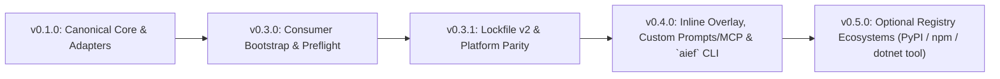

# Project Roadmap (`ROADMAP.md`)

**Version:** `0.4.0`  

---

## 1. Milestone Progression

---

## 2. Release Progression

### `v0.1.0` — Canonical Foundation, Agents, Skills & Tooling *(Released)*
- Canonical 15-phase workflow (`docs/WORKFLOW.md`), 4 core rules (`core/rules/`), 4 JSON schemas (`core/schemas/`), 8 canonical roles (`agents/*.md`), portable skills (`skills/` + `skills/registry.json`), 6 stage runbooks (`workflows/`), 5 platform adapter suites (`adapters/`), CLI utilities (`bootstrap.py`, `validate.py`, `sync_adapters.py`), CI templates (`.github/`), unit tests, and Graphify integration (`graphify-out/`).

### `v0.3.0` — Consumer Bootstrap Hardening & Stack Preflight *(Released)*
- Consumer/framework validation modes (`--mode auto|framework|consumer`), optional skill pack filtering, stack `.gitignore` templates, and Windows user-space `DOTNET_ROOT` preflight.

### `v0.3.1` — Multi-Platform Adapter Parity & Lockfile `v2.0.0`
- Canonical declarative capability model (`core/platform-capabilities.json`, `scripts/platform_capabilities.py`) and dynamic `.agents/skills.json` sync.
- Native skill projections (`.agents/skills/`, `.claude/skills/`), Lockfile `v2.0.0` ownership/pruning/atomic writes, legacy `v0.3.0` migration + backup, and consumer-safe adapter overrides.
- Claude/Copilot read-only agent tool mappings, clean Claude/Gemini settings schemas, schema-valid opt-in Antigravity `hooks.json`, and stdlib `scripts/readiness.py` HTTP probe.

### `v0.4.0` — Custom Composition Engine, Prompts/MCP & `aief` CLI *(Current)*
- Autonomous consumer composition engine (`scripts/compose.py`) composing active rules + `.framework-custom/` overlays inline across all 5 platforms without per-prompt manual reminders.
- Granular `disabled.*` (`skills`, `agents`, `phases`, `gates`, `mechanisms`) and `customizations.*` (`overlayDir`, `promptInjectionMode`, `inlineMaxBytes`) controls.
- Custom project skills (`consumer_custom_skill`), custom/appended agents (`consumer_custom_agent` with read-only reviewer enforcement), custom slash prompts (`consumer_custom_prompt`), custom MCP servers (`consumer_custom_mcp` with secret guards), curated skills `session-handoff` / `i-have-adhd` / `humanizer` (`33/33` total), PEP 517 `aief` package + version-bump auto-release GitHub Action (`.github/workflows/release-on-version-bump.yml`), first-run brownfield instruction auto-import (`.framework-custom/imported/`), Angular/VS Code JSONC support, `pnpm`/`yarn` preflight, and `84/84` automated tests.

### `v0.5.0`+ — Ecosystem Distribution *(Planned)*
- Optional PyPI Trusted Publishing activation (`PYPI_PUBLISH_ENABLED=true`) and thin `npx` / `dotnet tool` wrappers above the canonical Python engine.
- Helper commands (`aief bump`, `aief doctor`) and additional optional domain skill packs.
