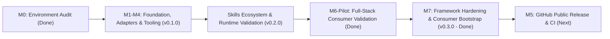

# Project Roadmap (`ROADMAP.md`)

**Version:** `0.3.0`  

---

## 1. Milestone Progression

---

## 2. Detailed Milestones

### Milestone M0 — Environment Audit & Architecture Blueprint *(Completed)*
- Empirical audit of Windows 11 host environment, runtimes, Git, GitHub CLI, and Antigravity capabilities (`docs/ENVIRONMENT_AUDIT.md`).
- Complete implementation plan and Category A/B/C task matrix (`docs/IMPLEMENTATION_PLAN.md`).
- Workspace established at `D:\PROGETTI\ai-engineering-framework` with Apache 2.0 license approved.

### Milestone M1 — Canonical Foundation & Core Schemas *(Completed in `v0.1.0`)*
- `PROJECT_CHARTER.md`, `README.md`, `LICENSE` (Apache 2.0), `.gitignore`, `.gitattributes`.
- Complete 15-phase operational SDLC workflow (`docs/WORKFLOW.md`).
- Architecture guide (`docs/ARCHITECTURE.md`), ADRs (`docs/adr/ADR-0001..0003`), and operational documentation (`GETTING_STARTED.md`, `INSTALLATION.md`, `CONFIGURATION.md`, `CONTRIBUTING.md`, `VERSIONING.md`, `SECURITY.md`).
- Canonical rules (`core/rules/`) and JSON validation schemas (`core/schemas/`).
- Consumer project artifact templates (`templates/`).

### Milestone M2 — Agent Role System & Portable Skills (`v0.1.0`)
- 8 non-redundant canonical agent roles (`agents/*.md`).
- Versioned skill registry (`skills/registry.json`).
- Core engineering skills (`grill-me`, `tdd-cycle`, `adr-writer`, `agent-browser`, `find-skills`, `anti-slop`).
- Opt-in domain skill packs (`communication/caveman`, `frontend-design/*`, `growth-media/*`).

### Milestone M3 — Multi-Platform Adapters & Stage Runbooks (`v0.1.0`)
- Universal root adapters (`AGENTS.md`, `CLAUDE.md`, `GEMINI.md`, `.github/copilot-instructions.md`).
- Platform-specific adapter packages in `adapters/{copilot,antigravity,claude-code,codex,gemini-cli}/` and `adapters/compatibility-matrix.md`.
- Automated adapter synchronization CLI (`scripts/sync_adapters.py`).
- 6 executable stage runbooks (`workflows/01..06-*.md`) and orchestration specs (`integrations/`).

### Milestone M4 — Quality, Security, Local Git & Graphify Verification (`v0.1.0`)
- Quality rubrics (`quality/`) and security policies/Strix profile (`security/`).
- Non-destructive installer (`scripts/bootstrap.py`) and repository validator (`scripts/validate.py`).
- GitHub Actions CI workflows (`.github/workflows/ci-validate.yml`, `security-audit.yml`) and issue/PR templates.
- Unit test suite (`tests/test_framework.py`) passing 100%.
- Local Git repository initialized on `main` with clean commit history and verified `graphify-out/` knowledge graph.

### Milestone M5 — Remote GitHub Provisioning & Live CI Verification (`v0.2.0` — Next)
- Interactive GitHub CLI authentication (`gh auth login`) or remote connection (**Category C / B**).
- Public repository creation at `https://github.com/Raele24/ai-engineering-framework` (**Category B**).
- Initial push of `main` branch and `v0.1.0` tag, followed by live GitHub Actions workflow execution and branch protection setup.

### Milestone M6 — Ecosystem Expansion (`v0.3.0` $\rightarrow$ `v1.0.0`)
- Stack-specific starter presets (e.g., `.NET + Angular`, `Python FastAPI`, `Next.js + Tailwind`, `GCP Data Pipelines`).
- Live Docker-backed Strix security runner validation in CI and local Docker environments.
- Optional state-machine bridges for LangGraph and Paperclip consuming `.framework-state/handoffs/`.
