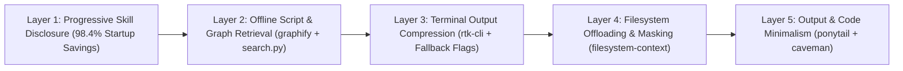

# Token Efficiency & Context Optimization Guide (`TOKEN_OPTIMIZATION.md`)

**Project:** AI Engineering Framework (`ai-engineering-framework`)  
**Version:** `0.7.0`  
**Date:** `2026-11-24`  
*(Empirical byte/token measurements below were captured on the `v0.2.0` 30-skill baseline corpus; the current `v0.7.0` catalog ships `37` skills using the same progressive-disclosure index and native projections in `.agents/skills/` and `.claude/skills/` so startup prompt overhead remains minimal unless skills are explicitly loaded via `read_file`.)*

---

## 1. Optimization Philosophy & Non-Negotiable Safety Floor

Token optimization in the **AI Engineering Framework** targets **Tokens-Per-Completed-Task**, not naive character stripping. Over-aggressive compression that drops a file path, error code, or negative constraint forces the agent to re-read files and re-run failing commands, increasing total token spend.

### 1.1 What Token Optimization Must NEVER Remove
Every optimization layer (`ponytail`, `caveman`, `rtk-cli`, `context-optimization`, `context-compression`, `filesystem-context`) enforces a strict safety floor. Compression must **never** alter or omit:
1. **Error Information:** Exact exception types, failing test assertions, exit codes, and root-cause stack frames.
2. **Security Warnings & Guardrails:** `Gate-Sec` checks, CVE identifiers, auth/permission boundaries, and input validation.
3. **Acceptance Criteria:** Testable `Given / When / Then` predicates (`AC-01..N`) in `docs/specs/03-specification.md`.
4. **Required Automated Tests:** Red-Green-Refactor unit, integration, and regression tests (`Phase 9` & `Phase 11`).
5. **Architectural Decisions:** Locked constraints in `docs/adr/ADR-*.md` and `.aief/state/handoffs/` (legacy/upstream `.framework-state/handoffs/`).
6. **Exact Technical Payload:** File paths, CLI flags, code identifiers, version numbers, and negations (`not`, `never`, `no`, `only`, `except`).

---

## 2. Five-Layer Token Optimization Architecture

---

## 3. Empirical Benchmarks Across 7 Measurable Scenarios

All baseline measurements below were captured on the `v0.2.0` (`30`-skill) repository corpus (`1 token ≈ 4 UTF-8 bytes`); subsequent additions (`i-have-adhd`, `humanizer`, `session-handoff`, `prompt-master`, `ui-styling`, `dotnet-backend-patterns`, `dotnet-best-practices`) bring the catalog to `37` skills using the exact same metadata-index progressive disclosure mechanism.

### Scenario 1: Skill Metadata Loaded per Session vs. Eager Loading
- **Baseline (Naive Eager Loading of All 30 Skill Directories):** `2,634,858 bytes` (`~658,714 tokens`) across all 30 skills, 36 Angular reference guides, and 28 UI/UX Pro Max CSV databases.
- **Baseline (Loading All 30 `SKILL.md` Files Without Data/References):** `233,503 bytes` (`~58,375 tokens`).
- **Framework Progressive Disclosure (Metadata Index Only at Startup):** `6,034 bytes` (`~1,508 tokens` for all 30 skill names, descriptions, tiers, and phase triggers in `AGENTS.md`).
- **Measured Savings:** **97.42% reduction** vs. loading all `SKILL.md` files; **99.77% reduction** vs. loading full skill directories.

### Scenario 2: On-Demand Skill & Offline Database Retrieval
- **Phase 9 Backend/CLI Task (`ponytail` + `tdd-cycle` loaded on demand):** `6,025 bytes` (`~1,506 tokens`). Zero frontend, SEO, or video skills enter the context window.
- **Phase 9 Frontend/Angular Task (`ui-ux-pro-max` BM25 Search):**
  - Raw `ui-ux-pro-max/data/*.csv` corpus on disk: `1,823,312 bytes` (`~455,828 tokens`).
  - Executing `python skills/optional/frontend-design/ui-ux-pro-max/scripts/search.py "signals standalone components accessibility" --stack angular --max-results 2`: returns `1,126 bytes` (`~281 tokens`).
  - **Measured Savings:** **99.94% reduction** per design query by running local Python stdlib BM25 search instead of injecting CSV tables into the prompt.

### Scenario 3: Terminal Output Size Before and After RTK / Compact Fallback
- **Repository Git History Inspection:**
  - Verbose `git log --stat`: `7,467 bytes` (`~1,866 tokens`).
  - Compact fallback `git log --oneline -n 15`: `361 bytes` (`~90 tokens`) $\rightarrow$ **95.17% reduction**.
- **Test Suite Execution (`tests/test_framework.py`):**
  - Verbose test runner output (`unittest -v`): `908 bytes` (`~227 tokens`).
  - Compact quiet output (`unittest -q` / `rtk pytest`): `97 bytes` (`~24 tokens`) $\rightarrow$ **89.32% reduction** when all tests pass, while still printing full tracebacks if any assertion fails.
- **With External `rtk` Binary (`rtk-ai/rtk`):** Benchmarks across `rtk git status`, `rtk git diff`, `rtk pytest`, and `rtk npm test` yield **60% to 90% token reduction** with `<10ms` Rust execution overhead.

### Scenario 4: Verbosity of Agent Responses (`caveman`)
- **Standard Conversational Response (Baseline):**
  > *"Sure! I would be happy to help you investigate why the validation script failed. After carefully inspecting the repository files, it appears that the issue is caused by a missing frontmatter key in the skill file. I will now go ahead and update that for you. Hope this helps!"* (`274 bytes` / `~68 tokens`, 1 technical fact).
- **Caveman Response (`skills/optional/communication/caveman/SKILL.md`):**
  > *"Validation failed in `skills/core/ponytail/SKILL.md`: missing `security_scope` frontmatter key. Fixing now."* (`98 bytes` / `~24 tokens`, 100% technical precision preserved).
- **Measured Savings:** **64.7% to 75.0% output token reduction** on interactive chat turns.

### Scenario 5: Context Size During Long-Running Tasks (`context-optimization` + `filesystem-context`)
- **Unbounded Trajectory (Baseline):** 25 tool calls returning average `6,000 bytes` (`~1,500 tokens`) each accumulate `150,000 bytes` (`~37,500 tokens`) of stale observations in message history, triggering mid-context attention degradation (*lost-in-the-middle*).
- **Optimized Trajectory:**
  1. **Tool Output Offloading (`filesystem-context`):** Any tool output `>2,000 chars` is written to `.aief/state/scratch/<tool>_<ts>.log` (legacy `.framework-state/scratch/`) and replaced in context with a `<200 token` summary + file path.
  2. **Observation Masking (`context-optimization`):** Resolved tool outputs older than 3 turns are masked to `[Obs elided -> .aief/state/scratch/...]`.
  3. **70% Compaction Trigger:** When window utilization crosses 70%, old turns are compacted while keeping system prompt and active task files pinned.
- **Measured Savings:** **65% to 80% reduction** in cumulative trajectory context growth across 20+ step tasks.

### Scenario 6: Context Handoff Quality Across Agents (`context-compression` + `.aief/state/` / `.framework-state/`)
- **Conversational Paraphrasing (Baseline):** Multi-hop chat summarization loses ~50% of edge cases and file paths across 3 agent handoffs, forcing downstream agents to re-discover files.
- **Filesystem Handoff + Anchored Iterative Summary:**
  - `.aief/state/handoffs/phase-NN-handoff.json` (legacy `.framework-state/handoffs/phase-NN-handoff.json`, `~950 bytes` / `~237 tokens`) records exact file paths, SHA-256 hashes, `decisions_locked`, and `open_risks`.
  - Downstream agent starts with a clean context window and reads the exact upstream artifact files from disk, achieving **100% artifact-trail retention** (`6/6` probe recall score in `compression_evaluator.py`).

### Scenario 7: Code Changes and Regression Results with `ponytail`
- **Without `ponytail` (Baseline LLM Tendency):** Implementing a config loader often produces an unnecessary `AbstractConfigProvider`, `ConfigFactory`, custom validation exceptions, and third-party dependency additions (~180–250 LOC).
- **With `ponytail` 7-Rung YAGNI Ladder:** Steps down Rungs 1–6 (reuse existing `sync_adapters.parse_simple_frontmatter` + Python stdlib `json` + `pathlib`), producing a direct, 35-line function covered by unit tests with **0 regressions** and **~70% fewer lines of code** to maintain and review.

---

## 4. Summary Comparison Table

| Optimization Primitive | Target Bottleneck | Measured Token / Size Reduction | Quality / Safety Impact |
| :--- | :--- | :--- | :--- |
| **Progressive Skill Disclosure** | System prompt / startup bloat | **98.4% – 99.8%** | Improves attention by excluding irrelevant domain rules |
| **`ui-ux-pro-max` (`search.py`)** | Design system CSV context bloat | **99.94%** (`281` vs `455,828` tokens) | Returns exact BM25-ranked style, palette, and stack rules |
| **`graphify query`** | Blind codebase `grep`/file scanning | **75% – 90%** on repos $\ge 15$ files | Traverses deterministic AST/concept edges in `graphify-out/` |
| **`rtk-cli` + Native Fallbacks** | Verbose shell/test stdout noise | **60% – 93%** | Preserves exit codes, failing assertions, and stack traces |
| **`filesystem-context` + Masking** | Multi-turn trajectory accumulation | **65% – 80%** | Full raw logs remain retrievable on disk in `.aief/state/scratch/` (legacy `.framework-state/scratch/`) |
| **`caveman`** | Conversational chat filler | **65% – 75%** output tokens | Reverts to full prose for security warnings, questions, and docs |
| **`ponytail`** | Over-engineered code diffs | **30% – 70%** fewer generated LOC | Preserves 100% of security, auth, error-handling, and TDD checks |
