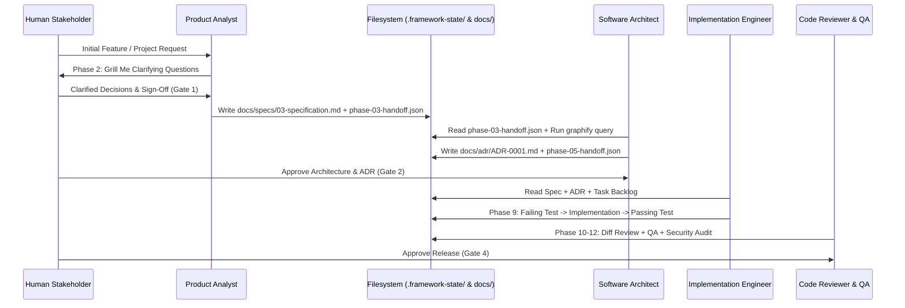

# Canonical Software Development Workflow (`WORKFLOW.md`)

**Status:** Canonical Source of Truth  
**Version:** `0.1.0`  
**Applies To:** All supported AI coding agents and platform adapters  

---

## 1. Operational Philosophy

This document defines the **15-phase canonical software development workflow** of the **AI Engineering Framework**.

1. **Operational, Not Theoretical:** Every phase specifies deterministic inputs, concrete file outputs, responsible agent roles, required skills, entry/exit criteria, quality gates, human approval checkpoints, and failure recovery procedures.
2. **Platform-Independent Source of Truth:** Platform adapters (`.github/`, `.agents/`, `.claude/`, `.codex/`, `.gemini/`) implement and route to this workflow; they never redefine it.
3. **Filesystem State Machine (`.framework-state/`):** Agents never rely on multi-turn chat paraphrasing to hand off work across stages. Every phase writes its primary deliverable to `docs/` or `src/` and emits a validated JSON handoff packet in `.framework-state/handoffs/`.

---

## 2. Inter-Phase Context & Handoff Protocol

### 2.1 Why Filesystem Handoffs Are Mandatory
When Agent A summarizes its work in chat for Agent B, repeated paraphrasing causes the **Telephone Game Problem** (loss of edge-case constraints, exact file paths, and negative requirements). To prevent context degradation:

1. **Artifact Persistence:** Each phase writes its deliverable to a canonical repository path (e.g., `docs/specs/03-specification.md`).
2. **Handoff Packet Generation:** At phase completion, the active agent writes `.framework-state/handoffs/phase-<NN>-handoff.json` conforming to [`core/schemas/handoff-packet.schema.json`](../core/schemas/handoff-packet.schema.json) and updates `.framework-state/manifest.json`.
3. **Clean-Context Ingestion:** The next agent starts with a clean context window, reads `.framework-state/manifest.json` and the upstream artifact files directly from disk, and verifies upstream exit criteria before executing.

### 2.2 Canonical Handoff Packet Structure
Every phase handoff packet in `.framework-state/handoffs/phase-<NN>-handoff.json` contains:
- `phase_id`: Integer (`1` through `15`) and slug (`"03-specification"`).
- `status`: `"completed"` | `"blocked"` | `"awaiting_human_approval"`.
- `producer_role`: Canonical role ID (e.g., `"product-analyst"`).
- `next_role`: Target role ID (e.g., `"software-architect"`).
- `input_artifacts`: Array of file paths consumed (with SHA-256 hashes).
- `output_artifacts`: Array of file paths produced (with SHA-256 hashes).
- `decisions_locked`: Array of explicit constraints that downstream agents must not violate.
- `open_risks`: Unresolved risks requiring downstream verification.
- `human_approval`: Object recording gate ID, approver status, and timestamp.

---

## 3. Master Lifecycle Overview (6 Stages, 15 Phases)

| Stage | Phase # | Phase Name | Responsible Agent Role | Primary Output Artifact | Human Gate |
| :--- | :--- | :--- | :--- | :--- | :--- |
| **Stage 1: Discovery & Specification** | **01** | Discovery & Requirements Gathering | `product-analyst` | `docs/specs/01-discovery-brief.md` | None |
| | **02** | Requirement Clarification (`Grill Me`) | `product-analyst` | `docs/specs/02-clarified-requirements.md` | **Gate-01a (Clarification Sign-Off)** |
| | **03** | Specification Creation | `product-analyst` | `docs/specs/03-specification.md` | **Gate-01b (Spec Approval)** |
| **Stage 2: Architecture & Research** | **04** | Technical Research | `software-architect` | `docs/architecture/04-research-spike.md` | None |
| | **05** | Architecture & ADR Creation | `software-architect` | `docs/architecture/ARCHITECTURE.md`, `docs/adr/ADR-xxxx.md` | **Gate-02 (Architecture Approval)** |
| **Stage 3: Planning & Delegation** | **06** | Project Planning | `planner-orchestrator` | `docs/plans/06-implementation-plan.md` | **Gate-03 (Plan Approval)** |
| | **07** | Build Phases & Task Decomposition | `planner-orchestrator` | `docs/plans/07-task-backlog.json` | None |
| | **08** | Agent Assignment & Delegation | `planner-orchestrator` | `.framework-state/08-assignments.json` | None |
| **Stage 4: TDD Implementation** | **09** | TDD & Implementation | `implementation-engineer` | Source code + Unit tests + `.framework-state/handoffs/phase-09-handoff.json` | Category B ops only |
| **Stage 5: Verification & Security** | **10** | Code Review | `code-reviewer` | `.framework-state/10-review-report.md` | Escalation only |
| | **11** | Automated Testing | `qa-engineer` | `.framework-state/11-test-report.json` | None |
| | **12** | Security Validation | `security-engineer` | `.framework-state/12-security-report.md` | **Gate-Sec (Before active DAST/Strix)** |
| **Stage 6: Release & Evolution** | **13** | CI/CD & Release | `devops-release-engineer` | Release tag, CI run, `CHANGELOG.md` | **Gate-04 (Release Approval)** |
| | **14** | Documentation Updates | `implementation-engineer` | Updated `README.md`, `docs/`, `graphify-out/` | None |
| | **15** | Retrospectives & Continuous Improvement | `planner-orchestrator` | `docs/retrospectives/RETRO-xxxx.md` | **Gate-05 (Rule/Skill Mutation Approval)** |

---

## 4. Detailed Specification of the 15 Phases

---

### Phase 1 — Discovery and Requirements Gathering

- **Purpose:** Capture the raw problem statement, business context, target users, existing system topology, and operational constraints before proposing solutions.
- **Required Inputs:** User request/prompt, existing repository files (if brownfield), and `graphify-out/GRAPH_REPORT.md` (if existing codebase).
- **Expected Outputs:**
  - `docs/specs/01-discovery-brief.md` (based on `templates/PRD.template.md`).
  - `.framework-state/handoffs/phase-01-handoff.json`.
- **Responsible Agent Role:** `product-analyst`.
- **Tools and Skills:** `read_file`, `search_web` (if market/domain lookup required), `graphify` skill (for brownfield context discovery).
- **Entry Criteria:** User initiates a new project, feature, or architectural change request.
- **Exit Criteria:** Problem statement, user personas, known constraints, and candidate ambiguities are documented in `01-discovery-brief.md`.
- **Quality Gates:** Brief contains zero implementation code; distinguishes verified facts from assumptions; lists all unresolved questions for Phase 2.
- **Human Approval Requirements:** None (automatically transitions to Phase 2).
- **Failure and Recovery Procedures:**
  - *Failure:* Agent jumps directly to architecture or coding without listing ambiguities.
  - *Recovery:* Orchestrator rejects output, deletes premature design sections, and re-runs Phase 1 restricted to read-only discovery tools.

---

### Phase 2 — Requirement Clarification and Grill Me Methodology

- **Purpose:** Systematically stress-test assumptions, uncover edge cases, resolve domain ambiguities, and lock scope boundaries through a structured, high-signal interview (`Grill Me`) with the human stakeholder.
- **Required Inputs:** `docs/specs/01-discovery-brief.md`.
- **Expected Outputs:**
  - `docs/specs/02-clarified-requirements.md` containing every question asked, options presented, user decisions, and locked invariants.
  - `.framework-state/handoffs/phase-02-handoff.json`.
- **Responsible Agent Role:** `product-analyst`.
- **Tools and Skills:** `grill-me` core skill (`skills/core/grill-me/SKILL.md`), `ask_question` tool (or structured multiple-choice questions with recommended defaults).
- **Entry Criteria:** `01-discovery-brief.md` exists and contains at least one open design question or assumption.
- **Exit Criteria:** All high-impact questions are answered by the user (or explicit defaults are approved), and zero `[AMBIGUOUS]` or `[TBD]` markers remain.
- **Quality Gates:**
  - Questions are batched (max 3–5 high-leverage questions per turn) with a recommended default option for each.
  - Failure modes, data retention/privacy rules, and non-goals are explicitly confirmed.
- **Human Approval Requirements:** **Mandatory (`Gate-01a`)** — The user must answer or approve the proposed defaults before Phase 3 begins.
- **Failure and Recovery Procedures:**
  - *Failure:* User provides partial or conflicting answers.
  - *Recovery:* Agent highlights the specific contradiction in 1–2 sentences, proposes a safe resolution default, and re-confirms only the conflicting item.

---

### Phase 3 — Specification Creation

- **Purpose:** Transform clarified requirements into a formal, testable engineering specification with deterministic acceptance criteria (`Given / When / Then`), data contracts, error states, and explicit non-goals.
- **Required Inputs:** `docs/specs/01-discovery-brief.md`, `docs/specs/02-clarified-requirements.md`.
- **Expected Outputs:**
  - `docs/specs/03-specification.md` (based on `templates/SPEC.template.md`).
  - `.framework-state/handoffs/phase-03-handoff.json`.
- **Responsible Agent Role:** `product-analyst`.
- **Tools and Skills:** `write_file`, `anti-slop` core skill (`skills/core/anti-slop/SKILL.md`).
- **Entry Criteria:** Phase 2 `Gate-01a` approved with zero `[AMBIGUOUS]` tags.
- **Exit Criteria:** `03-specification.md` defines functional requirements (`FR-01..N`), non-functional requirements (`NFR-01..N`), testable acceptance criteria (`AC-01..N`), and out-of-scope items.
- **Quality Gates:**
  - Every functional requirement maps to at least one testable acceptance criterion.
  - Prose passes `anti-slop` verification (zero vague adjectives like "seamless", "robust", or "fast" without numerical thresholds).
- **Human Approval Requirements:** **Mandatory (`Gate-01b: Spec Approval`)** — No architecture or code work starts until the specification is approved (for small tasks, `Gate-01b` and `Gate-02`/`Gate-03` may be combined into a single review turn).
- **Failure and Recovery Procedures:**
  - *Failure:* Acceptance criteria are untestable or subjective.
  - *Recovery:* Rewrite subjective statements into measurable predicates (e.g., replace "fast response" with "p95 latency < 200ms under 50 concurrent requests").

---

### Phase 4 — Technical Research

- **Purpose:** Investigate libraries, protocols, APIs, platform constraints, and feasibility spikes before locking architectural decisions.
- **Required Inputs:** `docs/specs/03-specification.md`.
- **Expected Outputs:**
  - `docs/architecture/04-research-spike.md`.
  - `.framework-state/handoffs/phase-04-handoff.json`.
- **Responsible Agent Role:** `software-architect` (delegating to `research` subagent where supported).
- **Tools and Skills:** `search_web`, `read_file`, `run_command` (for isolated prototype checks), `find-skills` (`skills/core/find-skills/SKILL.md`), `agent-browser` (if inspecting live docs/web apps), `graphify` (`graphify query`).
- **Entry Criteria:** `03-specification.md` is approved.
- **Exit Criteria:** Candidate technical approaches are evaluated across maintenance health, license compatibility, security posture, and complexity.
- **Quality Gates:** At least two viable alternatives (including "minimal/stdlib approach") are compared with explicit pros, cons, and rejection rationale.
- **Human Approval Requirements:** None (feeds directly into Phase 5 ADR).
- **Failure and Recovery Procedures:**
  - *Failure:* Selected library is deprecated, incompatible with host OS, or uses a conflicting license.
  - *Recovery:* Fallback to secondary option documented in `04-research-spike.md` or reopen Phase 3 if a specification constraint is impossible to satisfy.

---

### Phase 5 — Architecture and ADR Creation

- **Purpose:** Define system component boundaries, data schemas, interfaces, security controls, and record consequential choices in immutable Architecture Decision Records (ADRs).
- **Required Inputs:** `docs/specs/03-specification.md`, `docs/architecture/04-research-spike.md`, existing `graphify-out/graph.json` (if present).
- **Expected Outputs:**
  - Updated `docs/ARCHITECTURE.md` (or feature architecture doc).
  - One or more `docs/adr/ADR-xxxx-<slug>.md` files (based on `templates/ADR.template.md`).
  - `.framework-state/handoffs/phase-05-handoff.json`.
- **Responsible Agent Role:** `software-architect`.
- **Tools and Skills:** `adr-writer` core skill (`skills/core/adr-writer/SKILL.md`), `graphify` (`graphify path` / `graphify explain`), `project-development` principles (architectural reduction).
- **Entry Criteria:** Phase 4 research spike complete.
- **Exit Criteria:** Interfaces, data flow diagrams (Mermaid), module boundaries, and ADRs are written to disk.
- **Quality Gates:**
  - Architectural Reduction Check: Does the design introduce unnecessary abstractions, services, or dependencies?
  - Every ADR states Status, Context, Decision, Consequences (Positive/Negative), and Compliance check.
- **Human Approval Requirements:** **Mandatory (`Gate-02: Architecture & ADR Approval`)** whenever introducing new dependencies, database schema changes, authentication flows, or public API contracts.
- **Failure and Recovery Procedures:**
  - *Failure:* Proposed architecture violates an existing ADR or introduces circular module dependencies.
  - *Recovery:* Create a superseding ADR explicitly marking the old ADR as `Superseded by ADR-yyyy`, or refactor module boundaries to restore a directed acyclic dependency graph.

---

### Phase 6 — Project Planning

- **Purpose:** Sequence the implementation into verifiable milestones, estimate token/execution complexity, identify manual vs. automated tasks, and establish rollback checkpoints.
- **Required Inputs:** `docs/specs/03-specification.md`, `docs/ARCHITECTURE.md`, `docs/adr/ADR-*.md`.
- **Expected Outputs:**
  - `docs/plans/06-implementation-plan.md`.
  - `.framework-state/handoffs/phase-06-handoff.json`.
- **Responsible Agent Role:** `planner-orchestrator`.
- **Tools and Skills:** `read_file`, `write_file`.
- **Entry Criteria:** Architecture and ADRs approved (`Gate-02`).
- **Exit Criteria:** Milestones, dependency order, Category A/B/C task matrix, and verification commands are documented.
- **Quality Gates:** Every task is classified into Category A (autonomous), Category B (human approval), or Category C (manual user action).
- **Human Approval Requirements:** **Mandatory (`Gate-03: Implementation Plan Approval`)** before executing multi-phase builds.
- **Failure and Recovery Procedures:**
  - *Failure:* Plan contains circular dependencies or unverified environment assumptions.
  - *Recovery:* Cross-check plan against `docs/ENVIRONMENT_AUDIT.md` and reorder phases so prerequisites are built and tested first.

---

### Phase 7 — Build Phases and Task Decomposition

- **Purpose:** Break the approved implementation plan into atomic, independently testable work units with explicit file ownership and test targets.
- **Required Inputs:** `docs/plans/06-implementation-plan.md`, `docs/specs/03-specification.md`.
- **Expected Outputs:**
  - `docs/plans/07-task-backlog.json` (and human-readable section in `06-implementation-plan.md`).
  - `.framework-state/handoffs/phase-07-handoff.json`.
- **Responsible Agent Role:** `planner-orchestrator`.
- **Tools and Skills:** `write_file`.
- **Entry Criteria:** `06-implementation-plan.md` approved (`Gate-03`).
- **Exit Criteria:** Each task specifies: `task_id`, `title`, `spec_ac_refs` (links to `AC-xx`), `target_files`, `test_files`, `verification_command`, and `dependencies`.
- **Quality Gates:**
  - No single atomic task modifies more than one cohesive module boundary without justification.
  - Two parallel tasks must have disjoint `target_files` sets to prevent merge/edit collisions.
- **Human Approval Requirements:** None (internal decomposition of approved plan).
- **Failure and Recovery Procedures:**
  - *Failure:* Tasks are too coarse (exceeding single-agent context) or too granular (excessive handoff overhead).
  - *Recovery:* Re-bundle tasks so each atomic unit corresponds to one complete Red-Green-Refactor TDD cycle.

---

### Phase 8 — Agent Assignment and Delegation

- **Purpose:** Route each decomposed task to the appropriate execution mode (single-agent sequential, isolated subagent, or parallel swarm worker) with minimal required tool permissions and skills.
- **Required Inputs:** `docs/plans/07-task-backlog.json`, `skills/registry.json`.
- **Expected Outputs:**
  - `.framework-state/08-assignments.json`.
  - `.framework-state/handoffs/phase-08-handoff.json`.
- **Responsible Agent Role:** `planner-orchestrator`.
- **Tools and Skills:** `invoke_subagent` / `run_workflow` / `swarm` (when parallel execution is warranted), `find-skills`.
- **Entry Criteria:** Task backlog validated in Phase 7.
- **Exit Criteria:** Every task is assigned a role (`implementation-engineer`, `qa-engineer`, etc.), an explicit list of `SKILL.md` files to load, and an isolation mode (`inherit`, `share`, or `branch`).
- **Quality Gates:**
  - **Single-Agent First Rule:** Default to sequential single-agent execution unless tasks have independent file trees and parallel execution saves wall-clock time or prevents context saturation.
  - **Supervisor Cap:** Never assign more than 3–5 concurrent subagents to a single supervisor turn.
- **Human Approval Requirements:** Required only if installing a new external skill from a third-party repository (**Category B**).
- **Failure and Recovery Procedures:**
  - *Failure:* Subagent fails, stalls, or exceeds context budget.
  - *Recovery:* Read last valid checkpoint in `.framework-state/`, narrow the task scope, and re-invoke with a fresh context window.

---

### Phase 9 — Test-Driven Development (TDD) and Implementation

- **Purpose:** Implement features and fixes strictly following the **Red $\rightarrow$ Green $\rightarrow$ Refactor** cycle against approved specification acceptance criteria.
- **Required Inputs:** `docs/specs/03-specification.md`, `docs/adr/ADR-*.md`, `docs/plans/07-task-backlog.json`, `.framework-state/08-assignments.json`.
- **Expected Outputs:**
  - Unit/component test files proving each `AC-xx`.
  - Production implementation files satisfying the tests.
  - `.framework-state/handoffs/phase-09-handoff.json`.
- **Responsible Agent Role:** `implementation-engineer`.
- **Tools and Skills:** `tdd-cycle` core skill (`skills/core/tdd-cycle/SKILL.md`), stack-specific skills (e.g., `dotnet-backend-patterns`, `angular-developer`, `web-design-guidelines`), `read_file`, `write_file`, `edit_file`, `run_command`.
- **Entry Criteria:** Task assignment and upstream spec/ADR artifacts verified.
- **Exit Criteria:**
  1. **RED:** Test written first and verified to fail for the expected reason.
  2. **GREEN:** Minimal production code written to make the test pass.
  3. **REFACTOR:** Duplication removed, types/linting clean, all existing and new tests passing.
- **Quality Gates:**
  - Zero skipped or mocked-out assertions on the unit under test.
  - Linter, formatter, and type-checker return exit code `0`.
  - No unapproved dependencies added to package manifests.
- **Human Approval Requirements:** Autonomous (**Category A**) for workspace code/tests; **Category B approval required** before adding external packages, running database migrations against shared instances, or deleting persistent data.
- **Failure and Recovery Procedures:**
  - *Failure:* Implementation enters a 3x fix-and-fail loop on the same test.
  - *Recovery:* **Circuit Breaker Triggered** — Stop mutating code, revert uncommitted broken edits (`git checkout -- <file>`), document the root cause in `.framework-state/`, and escalate to `software-architect` or human user.

---

### Phase 10 — Code Review

- **Purpose:** Perform an independent, adversarial review of the implementation diff against the specification, ADRs, security rules, and architectural graph.
- **Required Inputs:** Git diff (`git diff`), `docs/specs/03-specification.md`, `docs/adr/ADR-*.md`, `quality/code-review-rubric.md`.
- **Expected Outputs:**
  - `.framework-state/10-review-report.md` (Pass / Changes Requested with file:line citations).
  - `.framework-state/handoffs/phase-10-handoff.json`.
- **Responsible Agent Role:** `code-reviewer` (**Must not be the same agent context that authored the code in Phase 9**).
- **Tools and Skills:** `read_file`, `run_command` (`git diff`, `git status`), `graphify` (`graphify update .`), `anti-slop` skill.
- **Entry Criteria:** Phase 9 TDD implementation complete and local unit tests passing.
- **Exit Criteria:** Review report classifies findings into `BLOCKER`, `MAJOR`, `MINOR`, or `NIT`. Zero `BLOCKER` or `MAJOR` findings remain unresolved.
- **Quality Gates:**
  - Every `AC-xx` in `03-specification.md` is traced to a concrete implementation and test assertion.
  - `graphify update .` confirms no unintended circular dependencies or architectural boundary violations.
  - No hardcoded secrets, debug print leftovers, or swallowed exceptions.
- **Human Approval Requirements:** Escalates to human if the reviewer and implementation engineer disagree after 2 review rounds, or if the diff alters public contracts.
- **Failure and Recovery Procedures:**
  - *Failure:* `BLOCKER` or `MAJOR` defects identified.
  - *Recovery:* Transition state back to **Phase 9 (`implementation-engineer`)** with `.framework-state/10-review-report.md` attached as required input.

---

### Phase 11 — Automated Testing (Integration, E2E, and Regression)

- **Purpose:** Verify system-level behavior across module boundaries, database/API contracts, and user-facing browser flows beyond isolated unit tests.
- **Required Inputs:** Passing Phase 9–10 codebase, `docs/specs/03-specification.md`, `templates/TEST_PLAN.template.md`.
- **Expected Outputs:**
  - Integration and E2E test suites.
  - `.framework-state/11-test-report.json` recording total tests, passed, failed, duration, and coverage metrics.
  - `.framework-state/handoffs/phase-11-handoff.json`.
- **Responsible Agent Role:** `qa-engineer`.
- **Tools and Skills:** `run_command` (`pytest`, `unittest`, `npm test`, `npx playwright test`), `agent-browser` skill (`skills/core/agent-browser/SKILL.md`), `browser` subagent (for live UI verification).
- **Entry Criteria:** Phase 10 Code Review passed with zero blockers.
- **Exit Criteria:** Full unit, integration, regression, and (where applicable) E2E Playwright suites pass with zero flaky or failing tests.
- **Quality Gates:**
  - Zero regression failures in existing test suites.
  - Edge cases (empty inputs, malformed payloads, boundary numbers, permission denials) explicitly tested.
- **Human Approval Requirements:** None for running local test suites; Category B approval required before installing heavy browser binaries (`npx playwright install`).
- **Failure and Recovery Procedures:**
  - *Failure:* Integration or E2E test fails.
  - *Recovery:* Capture exact failure log/screenshot in `.framework-state/11-test-report.json`, isolate reproduction in a minimal regression test, and return to **Phase 9**.

---

### Phase 12 — Security Validation

- **Purpose:** Audit the codebase and dependencies for leaked credentials, insecure coding patterns (OWASP Top 10), vulnerable packages, and (when explicitly authorized) dynamic security vulnerabilities.
- **Required Inputs:** Codebase, dependency manifests, `security/authorization-policy.md`, `security/pre-commit-secrets.md`.
- **Expected Outputs:**
  - `.framework-state/12-security-report.md`.
  - `.framework-state/handoffs/phase-12-handoff.json`.
- **Responsible Agent Role:** `security-engineer`.
- **Tools and Skills:** Static secret/pattern scanner (`scripts/validate.py` + `npm audit` / `pip-audit`), and conditional **Strix** (`security/strix-profile.yaml`) for authorized dynamic testing.
- **Entry Criteria:** Phase 11 Automated Testing passed.
- **Exit Criteria:** Zero leaked secrets/tokens, zero critical/high unmitigated CVEs, and all security guardrails verified.
- **Quality Gates:**
  - Secret scan across working tree and staged commits finds 0 matches.
  - Input validation, parameterized queries, and auth checks verified on all external entry points.
- **Human Approval Requirements:**
  - Passive/Static local checks: **Autonomous (Category A)**.
  - Active/Dynamic security scanning (e.g., **Strix** against a live target) or accepting a CVE waiver: **Mandatory Human Approval (`Gate-Sec`) + Signed Target Scope (`Category B/C`)**.
- **Failure and Recovery Procedures:**
  - *Failure:* Secret committed to local Git history or critical vulnerability detected.
  - *Recovery:* Halt release immediately. If a secret was committed locally, purge from Git history prior to any remote push and rotate the credential if ever exposed externally.

---

### Phase 13 — CI/CD and Release

- **Purpose:** Package, validate in continuous integration pipelines, tag with Semantic Versioning (`SemVer`), and publish/deploy the release safely.
- **Required Inputs:** Passing Phase 10, 11, and 12 reports; `.github/workflows/`; `docs/VERSIONING.md`.
- **Expected Outputs:**
  - Updated `CHANGELOG.md` and version metadata.
  - Local Git commit and SemVer tag (`vX.Y.Z`).
  - Remote GitHub push, Pull Request, or Release (after approval).
  - `.framework-state/handoffs/phase-13-handoff.json`.
- **Responsible Agent Role:** `devops-release-engineer`.
- **Tools and Skills:** `git`, `gh` CLI, `python scripts/validate.py`, GitHub Actions workflows.
- **Entry Criteria:** Phases 10, 11, and 12 all report `PASS`.
- **Exit Criteria:** Local validation script (`validate.py`) exits `0`, Git working tree is clean, and approved release artifacts are published.
- **Quality Gates:**
  - `python scripts/validate.py` and `python scripts/sync_adapters.py --check` pass with 0 errors.
  - Rollback procedure is documented before deployment executes.
- **Human Approval Requirements:** **Mandatory (`Gate-04: Release & Publish Approval`)** before pushing commits/tags to remote GitHub repositories, creating public releases, or deploying to staging/production environments.
- **Failure and Recovery Procedures:**
  - *Failure:* CI pipeline fails or post-deployment smoke check fails.
  - *Recovery:* Execute documented rollback (`git revert` or previous release tag restoration), record failure in `.framework-state/`, and return to Phase 9/11.

---

### Phase 14 — Documentation Updates

- **Purpose:** Synchronize all user-facing, developer-facing, and architectural documentation (including the Graphify knowledge graph) with the shipped state of the codebase.
- **Required Inputs:** Shipped code changes, `docs/specs/03-specification.md`, `docs/adr/ADR-*.md`.
- **Expected Outputs:**
  - Updated `README.md`, `docs/*.md`, inline API docstrings.
  - Updated `graphify-out/graph.json` and `graphify-out/GRAPH_REPORT.md` via `graphify update .`.
  - `.framework-state/handoffs/phase-14-handoff.json`.
- **Responsible Agent Role:** `implementation-engineer` / `software-architect`.
- **Tools and Skills:** `write_file`, `edit_file`, `graphify` skill, `anti-slop` skill, `scripts/validate.py`.
- **Entry Criteria:** Implementation and verification complete.
- **Exit Criteria:** All markdown links resolve, CLI usage examples match actual flags, and `graphify-out/` reflects current repository structure.
- **Quality Gates:** `python scripts/validate.py` verifies zero broken relative markdown links and 100% adapter sync.
- **Human Approval Requirements:** None for workspace documentation updates.
- **Failure and Recovery Procedures:**
  - *Failure:* `validate.py` detects broken links or outdated adapter files.
  - *Recovery:* Run `python scripts/sync_adapters.py` and fix broken relative links before closing Phase 14.

---

### Phase 15 — Retrospectives and Continuous Improvement

- **Purpose:** Analyze execution metrics, review failures, circuit-breaker activations, and human corrections from the completed cycle to propose bounded improvements to framework rules, skills, or templates.
- **Required Inputs:** `.framework-state/handoffs/phase-01..14-handoff.json`, review/test/security reports.
- **Expected Outputs:**
  - `docs/retrospectives/RETRO-xxxx-<slug>.md`.
  - Proposed diff (if any) to `core/rules/`, `skills/`, or `templates/`.
  - `.framework-state/handoffs/phase-15-handoff.json`.
- **Responsible Agent Role:** `planner-orchestrator`.
- **Tools and Skills:** `self-improvement-loops` and `evaluation` principles.
- **Entry Criteria:** Phases 1–14 complete for the milestone or feature cycle.
- **Exit Criteria:** Retrospective document records: What Worked, Friction/Failure Modes Encountered, Root Causes, and Bounded Action Items.
- **Quality Gates:**
  - **Bounded Mutation Rule:** An agent must never silently weaken a quality gate, delete a security check, or lower test coverage thresholds during self-improvement.
  - Every proposed rule or skill change must be validated by `python scripts/validate.py` and unit tests.
- **Human Approval Requirements:** **Mandatory (`Gate-05: Framework Evolution Approval`)** before modifying canonical rules in `core/rules/` or global agent configurations.
- **Failure and Recovery Procedures:**
  - *Failure:* Proposed rule change causes adapter sync failure or breaks existing tests.
  - *Recovery:* Revert rule edit immediately and keep the recommendation as a draft proposal in `docs/retrospectives/`.

---

## 5. Fast-Track Profiles (Scaling the Workflow to Task Size)

Not every engineering change requires 15 separate ceremony turns. The canonical workflow supports **three execution profiles** configured in `project.framework.json`, while preserving all quality and security invariants:

| Profile | Target Use Case | Phase Execution Path | Required Human Gates |
| :--- | :--- | :--- | :--- |
| **`full` (Default for New Projects & Major Features)** | New repositories, major features, database/auth changes | All 15 phases (`01` $\rightarrow$ `15`) | `Gate-01a`, `Gate-01b`, `Gate-02`, `Gate-03`, `Gate-Sec` (if active scan), `Gate-04` |
| **`standard` (Day-to-Day Feature & Refactoring)** | Scoped features within existing architecture | Phases `01–03` combined $\rightarrow$ `06–07` $\rightarrow$ `09` (TDD) $\rightarrow$ `10–12` $\rightarrow$ `13–14` | Combined `Spec + Plan Gate` + `Gate-04 (Release)` |
| **`hotfix` (Bug Fixes & Small Patches)** | Isolated bug reproduction and fix without architectural changes | Phase `03` (Minimal Bug Spec) $\rightarrow$ Phase `09` (Regression Test + Fix) $\rightarrow$ Phases `10–12` $\rightarrow$ `13` | `Gate-04 (Release)` |
